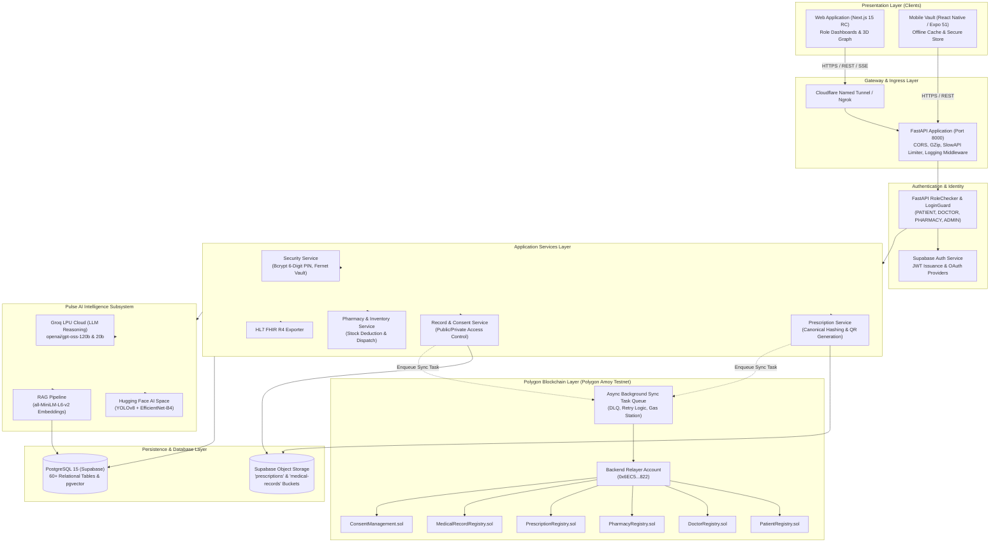
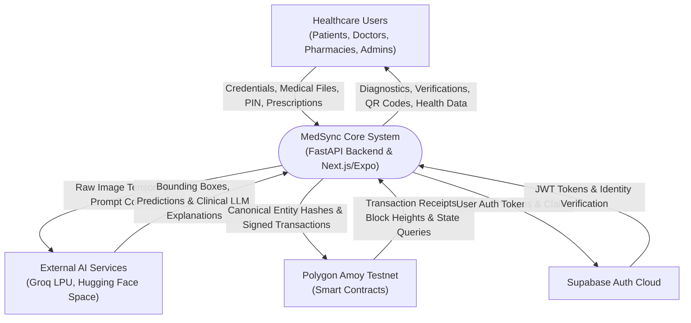
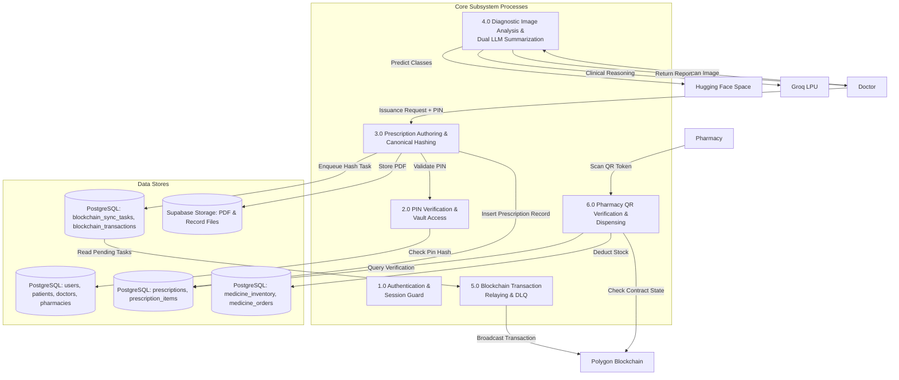
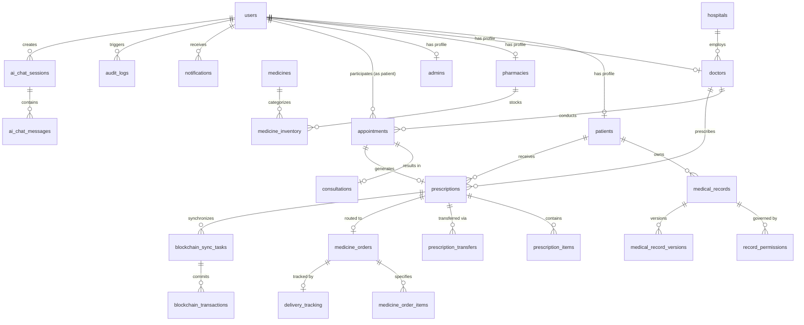

# MedSync: Technical Context and System Specification Report

> **Document Purpose**: Ground-truth technical specification and system architecture analysis of the MedSync codebase (`v1.0.0`). This document extracts verified implementation details, data schemas, API contracts, smart contract deployments, and testing metrics from the repository source code to serve as the reference context for generating an engineering project report.

---

## 1. Introduction

### 1.1 Project Overview & Purpose
**MedSync** is an enterprise-grade, decentralized healthcare ecosystem engineered to bridge Web2 clinical usability with Web3 cryptographic integrity and Artificial Intelligence (AI) clinical assistance. The platform unifies Electronic Health Records (EHR), electronic prescription management (e-Rx), appointment scheduling, and automated pharmaceutical dispensing across four dedicated user personas: **Patients**, **Doctors/Clinicians**, **Pharmacies**, and **System Administrators**.

The primary purpose of MedSync is to return health data sovereignty to patients while equipping clinicians and pharmacists with verifiable, tamper-evident workflows and AI-driven diagnostic decision support.

- **Primary Source Code Repositories**:
  - Web Application: [`apps/web/`](file:///c:/IMP%20PROJECTS/Medsync/apps/web) (Next.js 15 RC, React 19 RC, TypeScript, Tailwind CSS)
  - Backend API: [`apps/backend/`](file:///c:/IMP%20PROJECTS/Medsync/apps/backend) (FastAPI, SQLAlchemy 2.0 Async, Pydantic v2)
  - Mobile Application: [`apps/mobile/`](file:///c:/IMP%20PROJECTS/Medsync/apps/mobile) (React Native, Expo SDK 51/52, NativeWind)
  - Blockchain Registries: [`apps/blockchain/`](file:///c:/IMP%20PROJECTS/Medsync/apps/blockchain) (Solidity 0.8.24, Hardhat, Polygon Amoy)
  - Portable Container Runner: [`portable_runner/`](file:///c:/IMP%20PROJECTS/Medsync/portable_runner) (Docker Orchestration, Cloudflare/Ngrok tunnels)

### 1.2 Problem Statement
Modern healthcare data infrastructure suffers from fundamental structural vulnerabilities:
1. **Data Fragmentation and Silos**: Electronic medical records are trapped in disparate hospital database instances, forcing patients to physically transport paper reports and re-take redundant clinical tests.
2. **Prescription Tampering and Fraud**: Paper and unverified digital prescriptions are susceptible to forgery, double-dispensing, illegal narcotics alteration, and unauthorized pharmacy reuse.
3. **Absence of Patient Consent Controls**: Traditional EHR platforms store patient records in centralized cloud databases where data is accessed without real-time patient knowledge, granular permission revocation, or cryptographic audit trails.
4. **Diagnostic Delay and Clinical Overburden**: Clinicians face high diagnostic cognitive loads when interpreting high-volume radiology scans (fractures, brain tumors, kidney stones, dermatological lesions) without automated pre-screening tools.
5. **Lack of Verifiable Provider Credentialing**: Patients and pharmacies lack immediate, zero-trust mechanisms to verify whether a prescribing practitioner or dispensing outlet holds an active, unrevoked medical license.

### 1.3 Objectives
- **Cryptographic Record Verification**: Guarantee the immutability and authenticity of medical records and electronic prescriptions by anchoring SHA-256 state hashes on the Polygon blockchain.
- **Patient-Centric Access Control**: Enforce granular consent management where patients grant and revoke doctor access, secured by a mandatory 6-digit bcrypt-hashed Authorization PIN.
- **Closed-Loop E-Prescription Lifecycle**: Implement an end-to-end prescription pipeline: Doctor issuance $\rightarrow$ Dynamic QR generation $\rightarrow$ Blockchain hash anchoring $\rightarrow$ Direct pharmacy routing $\rightarrow$ Inventory deduction $\rightarrow$ Dispensing validation.
- **Dual-Perspective Clinical AI (Pulse AI)**: Deliver automated computer vision screening (YOLO and EfficientNet) paired with Groq LLMs (`openai/gpt-oss-120b` and `openai/gpt-oss-20b`) to generate both technical differential diagnoses for doctors and clear, educational explanations for patients.
- **Interoperability Standard Compliance**: Expose HL7 FHIR R4 standard-compliant REST resources (`Patient`, `Practitioner`, `MedicationRequest`, `MedicationDispense`, `Bundle`).
- **Flexible Edge and Cloud Deployment**: Provide dual deployment topologies: automated Render Cloud deployment with Supabase, alongside an on-premises Dockerized "Portable Runner" with Cloudflare/Ngrok tunneling for bandwidth-constrained clinics.

### 1.4 Scope of the Project
- **Included**:
  - Web dashboards for Patients, Doctors, Pharmacies, and Admins.
  - Cross-platform patient mobile vault (Android APK / Expo).
  - Asynchronous background worker syncing hashes to 6 Solidity smart contracts on the Polygon Amoy testnet.
  - Multi-modal diagnostic microservice processing bone X-rays, brain MRIs, kidney CTs, and skin lesion dermatoscopy.
  - Admin observability suite featuring a 3D Three.js force-directed entity relationship constellation graph, Dead Letter Queue (DLQ) replays, and real-time gas monitoring.
  - Pharmaceutical inventory tracking with automated batch expiry warnings and restock workflows.
- **Excluded**:
  - Live production credit card/fiat gateway clearing (simulated transaction tokens are utilized).
  - Direct real-time GPS telemetry from hardware vehicle trackers (simulated coordinate interpolation is utilized for delivery tracking).
  - Live hardware facial biometric cameras in production (biometric auth has transitioned to 6-digit cryptographic PIN verification).

### 1.5 Limitations of Existing Systems vs. Proposed MedSync Solution

| Feature / Domain | Traditional Centralized EHR (Epic, Cerner) | Web3 Health DApps (Pure On-Chain) | MedSync Proposed Solution |
| :--- | :--- | :--- | :--- |
| **Data Storage** | Centralized proprietary databases vulnerable to single-point failure | Entire records stored on-chain (expensive, public, HIPAA non-compliant) | **Hybrid Architecture**: Encrypted storage in Supabase Storage; only SHA-256 canonical hashes anchored on Polygon Amoy. |
| **Patient Authorization** | Administrative staff grant internal permissions | Raw Web3 wallet signing required (confusing for non-technical patients) | **6-Digit Authorization PIN**: Bcrypt-hashed with Fernet-encrypted vault credentials, requiring no Web3 wallet knowledge from patient. |
| **Prescription Security** | Plain PDF or physical paper easily forged | Basic smart contract token without pharmacy workflow integration | **Cryptographic QR Lifecycle**: Canonical JSON hashing, doctor PIN verification, QR token binding (`MS-RX-{id}`), and real-time pharmacy inventory deduction. |
| **AI Integration** | Third-party closed black-box plugins | None (smart contracts cannot run neural networks) | **Pulse AI Subsystem**: Hybrid external inference (HF Space + Groq LPU) providing parallel doctor clinical summaries and patient layperson explanations. |
| **Interoperability** | Siloed API adapters requiring complex enterprise agreements | Custom blockchain ABIs incompatible with medical systems | **Native HL7 FHIR R4**: Built-in REST endpoints serializing records directly into standard FHIR Bundles. |

---

## 2. Literature Survey & Technological Foundations

### 2.1 Technological Context & Existing Healthcare Solutions
The evolution of health informatics has transitioned from paper-based medical charts to centralized Electronic Medical Record (EMR) systems, and currently toward decentralized, patient-mediated health data exchanges (HIEs).

1. **Centralized Health Information Exchanges (HIEs)**:
   - *Architecture*: Centralized regional repositories aggregating hospital data.
   - *Shortcomings*: Vulnerable to ransomware, centralized data breaches, vendor lock-in, and lack of real-time patient consent granularity.
2. **Blockchain in Healthcare (Decentralized Identity & Integrity)**:
   - *Architecture*: Ethereum/Hyperledger implementations recording patient interactions.
   - *Shortcomings*: Storing Protected Health Information (PHI) directly on a public blockchain violates HIPAA and GDPR "Right to be Forgotten" mandates. Public gas volatility and required Web3 browser extensions (e.g., MetaMask) create massive adoption barriers for patients and doctors.
3. **Clinical Decision Support Systems (CDSS)**:
   - *Architecture*: Rule-based expert systems or isolated convolutional neural networks (CNNs).
   - *Shortcomings*: Lack of natural-language reasoning. Typical CNN outputs (e.g., raw softmax probability 0.89) provide no differential diagnostic reasoning or treatment contraindications.

### 2.2 Gaps Addressed by MedSync
- **Zero On-Chain PHI**: MedSync strictly preserves privacy compliance by keeping all personally identifiable and clinical data off-chain in encrypted storage. Only one-way cryptographic SHA-256 digests (`0x...`) are committed to smart contracts.
- **Relayer Wallet Pattern (Gasless for End-Users)**: End users (doctors, patients, pharmacies) never manage MATIC/POL gas tokens or sign raw transactions. The backend maintains an authorized relayer account (`MEDSYNC_WALLET_ADDRESS: 0x6EC559064e5BfAE4a98d1879c717139aceE49822`) that manages nonce sequencing and gas costs.
- **Dual-Perspective LLM Explanation**: Diagnostic classification from vision models is piped through Groq's high-throughput LPU running open-weight LLMs (`openai/gpt-oss-120b` and `openai/gpt-oss-20b`). It concurrently constructs two outputs:
  1. High-level clinical differential diagnoses, ICD considerations, and follow-up scan recommendations for the Doctor.
  2. Empathetic, jargon-free explanations with safety disclaimers for the Patient.

### 2.3 Verified Open-Source Foundations & Research References
*(Extracted directly from project dependencies and implementation references; no papers are invented)*
- **Computer Vision & Neural Networks**:
  - Ultralytics YOLO architecture for real-time anatomical object detection (used in `ai/services/yolo.py` for bone fracture localization).
  - EfficientNet-B4 convolutional neural network architecture for multi-class image classification (used in `ai/services/efficientnet.py` for dermatological lesion assessment).
- **Standards & Cryptography**:
  - **HL7 FHIR Release 4 (R4)**: Standardized data model used for clinical interoperability in [`apps/backend/app/schemas/fhir.py`](file:///c:/IMP%20PROJECTS/Medsync/apps/backend/app/schemas/fhir.py).
  - **OpenZeppelin Contracts v5.0.2**: Industry-standard implementations of `AccessControl`, `Pausable`, and `ReentrancyGuard` deployed in [`apps/blockchain/contracts/`](file:///c:/IMP%20PROJECTS/Medsync/apps/blockchain/contracts/).
  - **ERC-165**: Standard interface detection implemented across all MedSync registry contracts.
  - **Bcrypt (RFC 2898 / OpenBSD)**: Used for one-way salting and hashing of 6-digit patient, doctor, and pharmacy Authorization PINs.
  - **Fernet (AES-128-CBC with HMAC-SHA256)**: Cryptographic standard used in [`apps/backend/app/services/security_service.py`](file:///c:/IMP%20PROJECTS/Medsync/apps/backend/app/services/security_service.py) for biometric and sensitive credential envelope encryption.
- **High-Throughput Inference Engine**:
  - Groq Language Processing Unit (LPU) inference engine utilizing `openai/gpt-oss-120b` and `openai/gpt-oss-20b` via the Groq Async Python SDK.
  - Hugging Face Spaces containerized hosting for microservice-based PyTorch/Torchvision inference.

---

## 3. Software Requirement Specification (SRS)

### 3.1 Technology Stack

#### Frontend Technologies
- **Web Portal Framework**: Next.js 15.0.0-rc.0 (App Router architecture, React 19 RC).
- **Language**: TypeScript 5.x.
- **Styling & UI Components**: Tailwind CSS 3.4.1, `shadcn/ui` primitive components via `@radix-ui`, `lucide-react` icons.
- **State Management & Caching**: TanStack React Query v5.50.0, Zustand v4.5.4.
- **Data Visualization & 3D Graphics**: Three.js v0.185.1, `@react-three/fiber` v9.7.0, `@react-three/drei` v10.7.8, `react-force-graph-3d` v1.29.2, `react-force-graph-2d` v1.29.2, `d3-force-3d` v3.0.6, `recharts` v3.10.1.
- **Interactive Mapping**: Leaflet 1.9.4, `react-leaflet` 5.0.0.
- **QR Code Scanning & Generation**: `html5-qrcode` 2.3.8, `react-qr-code` 2.2.0, `qrcode.react` 4.2.0.
- **Mobile Framework**: React Native 0.74.5, Expo SDK ~51.0.14 / 52, Expo Router ~3.5.16, NativeWind v4.0.1.
- **Mobile Storage & Biometrics**: `expo-secure-store` ~13.0.2, `expo-local-authentication` 14.0.1, `expo-file-system` ~17.0.1.

#### Backend Technologies
- **API Framework**: FastAPI 0.111.0 (Python 3.11.9).
- **Asynchronous Web Server**: Uvicorn 0.30.1.
- **ORM & Database Client**: SQLAlchemy 2.0.30 (AsyncIO engine), `asyncpg` 0.29.0, `psycopg2-binary` 2.9.9.
- **Database Migrations**: Alembic 1.13.1.
- **Data Validation & Serialization**: Pydantic v2.7.4, `pydantic-settings` 2.3.4 (`model_config = ConfigDict(use_enum_values=True)`).
- **Authentication & Cryptography**: `python-jose` 3.3.0, `passlib` 1.7.4, `bcrypt` 4.1.3, `cryptography` 42.0.8 (Fernet).
- **Rate Limiting**: SlowAPI 0.1.9 (in-memory sliding window limiter).
- **PDF & Document Processing**: ReportLab, PyPDF2 3.0.1, `pypdf` 4.3.1, `python-docx` 1.1.0, `qrcode`.
- **Computer Vision & OCR**: OpenCV headless 4.10.0.84, Pillow 10.3.0, Tesseract OCR via `pytesseract` 0.3.10.

#### Database & Storage
- **Relational Database**: PostgreSQL 15 (hosted via Supabase Database and Docker).
- **Vector Search Engine**: `pgvector` 0.2.1 extension in PostgreSQL.
- **Blob / Object Storage**: Supabase Storage buckets (`prescriptions`, `medical-records`).

#### Blockchain & Web3
- **Network**: Polygon Amoy Testnet (Chain ID: `80002`).
- **Smart Contract Language**: Solidity 0.8.24 / 0.8.20.
- **Development Environment**: Hardhat 2.22.2, `@nomicfoundation/hardhat-toolbox` 4.0.0.
- **Contract Standard**: OpenZeppelin Contracts v5.0.2.
- **Web3 Integration**: Web3.py 6.19.0, `eth-account` 0.11.2, Ethers.js v6.17.0 (frontend explorer).
- **RPC Providers**: `https://polygon-amoy-bor-rpc.publicnode.com`, `https://polygon-amoy.drpc.org`.

#### Artificial Intelligence & Machine Learning
- **Clinical Reasoning Engine**: Groq Cloud LPU API (`openai/gpt-oss-120b` for clinician reasoning, `openai/gpt-oss-20b` for patient guidance and conversational fallback).
- **Deep Learning Frameworks**: PyTorch 2.x, Torchvision, NumPy, Pillow (PIL 10.3.0), OpenCV Headless (4.10.0.84).
- **Diagnostic Vision Microservices**: Hosted Hugging Face Space (`https://dharshan8197-medsync-ai.hf.space`):
  - Bone Fracture object detection (Ultralytics YOLO architecture, `models/bone.pt`, 22.5 MB).
  - Dermatological Lesion multi-class classification (EfficientNet-B4 architecture, `models/skin_model.pt`, 16.3 MB).
  - Brain MRI scan tumor detection (CNN/EfficientNet architecture, `models/brain.pt`, 6.2 MB).
  - Kidney CT scan stone detection (CNN/EfficientNet architecture, `models/kidney.pt`, 6.2 MB).
- **Feature Localization**: In-house mathematical saliency contrast algorithm (luminance & erythema channel differentials) for normalized bounding-box extraction.
- **Vector Embeddings & RAG**: `sentence-transformers/all-MiniLM-L6-v2` (384-dimensional dense semantic vectors with LRU caching) paired with PostgreSQL `pgvector` (0.2.1).
- **Document AI & OCR**: Tesseract OCR via `pytesseract` 0.3.10, `pypdf` 4.3.1, PyPDF2 3.0.1, ReportLab.
- **Safety & Schema Guards**: 14 regex prompt-injection pattern guards and strict Pydantic JSON-mode schema validation (`GroqClinicalSummary`, `GroqPatientExplanation`).

#### DevOps, Cloud & Tooling
- **Containerization**: Docker multi-stage builds, Docker Compose v2.
- **Package Management**: PNPM 10.0.0 (Monorepo workspaces via `pnpm-workspace.yaml`).
- **Cloud Deployment**: Render Cloud (Backend Web Service), Vercel (Next.js Web Portal), Expo Application Services (EAS Build for Android APK).
- **Tunneling**: Persistent Cloudflare Named Tunnels, Ngrok.

---

### 3.2 Hardware and Software Requirements

#### Development & Server Hardware Requirements
- **Processor**: 4-core 64-bit x86_64 or ARM64 processor (Intel Core i5/i7, AMD Ryzen 5/7, or Apple Silicon M-series).
- **Memory (RAM)**:
  - Backend execution (standalone): Minimum 2 GB RAM.
  - Full local Docker container stack (Backend + Postgres + Models cache): Minimum 4 GB RAM (8 GB recommended).
  - Full monorepo build (Next.js compilation + TypeScript check): Minimum 8 GB RAM.
- **Disk Storage**: 10 GB free solid-state storage (for Docker base images, node_modules, and PyTorch model weights).
- **Network Interface**: Active broadband connection for Polygon Amoy RPC calls and Groq/HuggingFace API calls.

#### Client Device Requirements
- **Web Client**: Any modern web browser supporting WebGL and ECMAScript 2022+ (Google Chrome 110+, Mozilla Firefox 115+, Microsoft Edge 110+, Safari 16+).
- **Mobile Client**: Android device running Android 9.0 (API Level 28) or higher, or iOS device running iOS 14.0 or higher. Minimum 2 GB RAM, rear camera required for physical QR code scanning.

---

### 3.3 Functional Requirements

- **FR-01: Authentication & User Synchronization**: The system shall authenticate users via Supabase Auth (Email/Password and Google OAuth), synchronize user profiles into the local `users` database via `/api/v1/auth/sync`, and enforce role verification via `/api/v1/auth/login-guard`.
- **FR-02: Cryptographic Authorization PIN**: Every patient, doctor, and pharmacy must enroll a 6-digit PIN hashed via bcrypt (`/api/v1/security/enroll-pin`). The PIN is mandatory to authorize prescription creation, record uploads, record sharing, and document downloads.
- **FR-03: Medical Record Ingestion & Encryption**: Patients must be able to upload PDF or image medical records. The system computes a SHA-256 hash, uploads the binary to Supabase Storage, and registers metadata in PostgreSQL.
- **FR-04: Dynamic Patient Consent Management**: Patients must be able to toggle the access level of any medical record or consultation between `PRIVATE` and `PUBLIC`, grant explicit time-bound access to consulting doctors, or revoke access immediately.
- **FR-05: Electronic Prescription Issuance**: Doctors must be able to compile prescription orders with diagnosis, medication items (name, dosage, frequency, duration, instructions), and electronically sign them using their 6-digit PIN. The system creates a canonical JSON payload, calculates its SHA-256 hash, generates a PDF with an embedded verification QR code, and uploads it to storage.
- **FR-06: Asynchronous Blockchain Synchronization**: When a doctor issues a prescription, registers a patient, or verifies a license, the backend must enqueue an asynchronous task (`blockchain_sync_tasks`) and execute a blockchain transaction on Polygon Amoy without blocking the HTTP request thread.
- **FR-07: Closed-Loop Pharmacy Fulfillment**: Pharmacies must be able to scan prescription QR codes (`MS-RX-{id}`), verify prescription validity and patient authorization, inspect local medicine inventory, deduct stock, and transition orders to `DISPENSED`.
- **FR-08: Multi-Modal AI Image Analysis**: Doctors must be able to upload radiographic or dermatoscopic imagery specifying the scan type (`bone`, `brain`, `kidney`, `skin`). The backend routes the payload to the AI microservice, receives tensor predictions and normalized bounding boxes, and queries Groq to construct dual clinical/patient summaries.
- **FR-09: Prompt Injection Defense**: The AI chat orchestrator must filter all incoming messages against regex prompt injection patterns (`ignore previous instructions`, `DAN mode`, `system:`, `jailbreak`) and reject malicious inputs.
- **FR-10: Admin Observability & DLQ Recovery**: Administrators must have access to a real-time system dashboard, an interactive 3D relationship graph of all registered entities, and the ability to view and replay failed blockchain transactions from the Dead Letter Queue.
- **FR-11: HL7 FHIR Standard Export**: The backend must export healthcare resources formatted in HL7 FHIR R4 JSON schemas (`Patient`, `Practitioner`, `MedicationRequest`, `MedicationDispense`, `DocumentReference`, and aggregate `Bundle`).
- **FR-12: Doctor Cross-Consultation & Referrals**: Doctors must be able to refer patients to specialist clinicians (`/api/v1/doctor-collaboration/referrals`) and request patient record access from previous attending physicians.

---

### 3.4 Non-Functional Requirements

- **NFR-01: Security & Confidentiality**:
  - Zero Protected Health Information (PHI) shall be committed to the public blockchain.
  - All communication must run over TLS 1.3 / HTTPS.
  - HTTP security headers (`X-Content-Type-Options: nosniff`, `X-Frame-Options: DENY`, `X-XSS-Protection: 1; mode=block`, `Referrer-Policy: strict-origin-when-cross-origin`) must be enforced on every API response.
  - Rate limiting must prevent brute-force attacks on PIN endpoints (max 5 failed attempts before a 15-minute lockout).
- **NFR-02: Performance & Latency**:
  - Standard REST API endpoints must respond in $< 200\text{ ms}$ under normal database load.
  - Groq LLM streaming responses must yield the first token (Time-to-First-Token) in $< 600\text{ ms}$.
  - Vision model inference via Hugging Face must return within $3000\text{ ms}$ (excluding cold-starts).
- **NFR-03: Reliability & Fault Tolerance**:
  - Blockchain operations must not crash user workflows if the Polygon RPC node is slow or unreachable; transactions are queued with retry counters and exponential backoff.
  - If external AI microservices become unavailable, the API must fail gracefully by returning verified clinical findings without crashing the consultation workflow.
- **NFR-04: Scalability**:
  - The backend stateless architecture allows horizontal replication behind reverse proxies and load balancers.
  - Database access is managed via an asynchronous connection pool (`SQLAlchemy AsyncEngine` with `asyncpg`).
- **NFR-05: Maintainability & Type Safety**:
  - The codebase must enforce strict type safety: Pydantic v2 schemas on all backend endpoints, TypeScript `strict: true` across all frontend and blockchain packages.

---

### 3.5 User Roles, Permissions & Constraints

| Role | Permissions & Accessible Modules | Restrictions & Prohibited Actions |
| :--- | :--- | :--- |
| **PATIENT** | View own records, view/download own prescriptions via PIN, grant/revoke doctor consent, book appointments, place medicine orders, track deliveries, use Patient Pulse AI chat. | Cannot view other patients' records; cannot access raw AI diagnostic scan endpoints (`/api/v1/ai/analyze-image` restricted); cannot alter prescription statuses. |
| **DOCTOR** | Access verified patient records (with consent), create & finalize prescriptions via PIN, review diagnostic AI scans, conduct appointments, record consultations, submit referrals, request records from peers. | Cannot modify prescriptions once finalized; cannot access pharmacy inventory management; cannot bypass patient consent revocation. |
| **PHARMACY** | Scan & verify prescription QR codes, resolve pharmacy QR identifiers, view assigned orders, update order status (Dispatch), manage medicine inventory, initiate restock orders, view sales analytics. | Cannot access doctor consultation workspaces; cannot upload diagnostic imagery; cannot edit prescription medication dosages. |
| **ADMIN** | Review pending doctor & pharmacy verification requests (Approve/Reject), view system health & metrics, access 3D Constellation Graph, trigger blockchain DLQ replays, manage RAG knowledge base. | Restricted by audit logging on all administrative actions; cannot fabricate clinical prescriptions. |

---

## 4. System Design

### 4.1 Architecture Diagram



---

### 4.2 Use-Case Diagram

```mermaid
flowchart LR
    subgraph Actors["System Actors"]
        Patient((Patient))
        Doctor((Doctor))
        Pharmacy((Pharmacy))
        Admin((Admin))
    end

    subgraph PatientCases["Patient Use Cases"]
        UC_P1["Setup / Reset 6-Digit PIN"]
        UC_P2["Upload & Manage Medical Records"]
        UC_P3["Toggle Public / Private Consent"]
        UC_P4["Authorize Prescription Download (PIN)"]
        UC_P5["Place Medicine Order"]
        UC_P6["Track Medicine Delivery"]
        UC_P7["Consult Patient Pulse AI"]
    end

    subgraph DoctorCases["Doctor Use Cases"]
        UC_D1["Review Assigned Appointments"]
        UC_D2["Conduct Consultation & Notes"]
        UC_D3["Analyze Medical Scans (YOLO / EfficientNet)"]
        UC_D4["Create & Finalize Prescription (PIN)"]
        UC_D5["Refer Patient to Specialist"]
        UC_D6["Request Record Access from Peer"]
    end

    subgraph PharmacyCases["Pharmacy Use Cases"]
        UC_Ph1["Scan & Verify Prescription QR"]
        UC_Ph2["Verify Blockchain Authenticity"]
        UC_Ph3["Manage Drug Inventory & Batches"]
        UC_Ph4["Dispatch Order & Simulate Delivery"]
        UC_Ph5["Order Inventory Restock"]
    end

    subgraph AdminCases["Admin Use Cases"]
        UC_A1["Approve / Reject Doctor & Pharmacy KYC"]
        UC_A2["Inspect 3D Constellation Entity Graph"]
        UC_A3["Monitor Blockchain Gas & Health"]
        UC_A4["Replay Failed Transactions (DLQ)"]
        UC_A5["Ingest Knowledge Documents (RAG)"]
    end

    Patient --> UC_P1
    Patient --> UC_P2
    Patient --> UC_P3
    Patient --> UC_P4
    Patient --> UC_P5
    Patient --> UC_P6
    Patient --> UC_P7

    Doctor --> UC_D1
    Doctor --> UC_D2
    Doctor --> UC_D3
    Doctor --> UC_D4
    Doctor --> UC_D5
    Doctor --> UC_D6

    Pharmacy --> UC_Ph1
    Pharmacy --> UC_Ph2
    Pharmacy --> UC_Ph3
    Pharmacy --> UC_Ph4
    Pharmacy --> UC_Ph5

    Admin --> UC_A1
    Admin --> UC_A2
    Admin --> UC_A3
    Admin --> UC_A4
    Admin --> UC_A5
```



---

### 4.3 Data-Flow Diagrams (DFD)

#### DFD Level 0 (Context Level)



#### DFD Level 1 (Decomposed Core Processes)



---

### 4.4 Entity-Relationship (ER) Overview



---

### 4.5 Detailed Database Schema (Tables, Fields, Keys & Relationships)

The MedSync PostgreSQL schema comprises 60+ relational tables mapped via SQLAlchemy 2.0. Below is the specification of the core domain tables extracted from [`database/00_database_setup.sql`](file:///c:/IMP%20PROJECTS/Medsync/database/00_database_setup.sql) and migration scripts `01` through `10`:

#### 1. `users`
- **Purpose**: Root identity table synchronized with Supabase Auth (`auth.users`).
- **Primary Key**: `id` (UUID).
- **Columns**:
  - `email` (VARCHAR(255), UNIQUE, NOT NULL, indexed).
  - `password_hash` (VARCHAR(255), default `'supabase_managed'`).
  - `role` (public.userrole ENUM: `'PATIENT'`, `'DOCTOR'`, `'PHARMACY'`, `'HOSPITAL'`, `'ADMIN'`).
  - `status` (public.userstatus ENUM: `'ACTIVE'`, `'PENDING'`, `'SUSPENDED'`, `'INACTIVE'`).
  - `is_verified` (BOOLEAN, default `FALSE`).
  - `profile_completion_percentage` (INTEGER, default `0`).
  - `created_at`, `updated_at` (TIMESTAMP).
- **Triggers**: Synchronized automatically on user signup via PostgreSQL trigger function `public.handle_new_user()`.

#### 2. `patients`
- **Primary Key**: `id` (UUID).
- **Foreign Key**: `user_id` $\rightarrow$ `users(id)` ON DELETE CASCADE.
- **Columns**: `full_name`, `date_of_birth`, `gender`, `blood_group`, `phone_number` (aliased to `contact_number`), `address`, `city`, `state`, `postal_code`, `pin_hash` (VARCHAR(255) for 6-digit PIN), `height_cm` (NUMERIC), `weight_kg` (NUMERIC), `emergency_contact_name`, `emergency_contact_phone`.

#### 3. `doctors`
- **Primary Key**: `id` (UUID).
- **Foreign Key**: `user_id` $\rightarrow$ `users(id)` ON DELETE CASCADE; `hospital_id` $\rightarrow$ `hospitals(id)` ON DELETE SET NULL.
- **Columns**: `full_name`, `license_number` (UNIQUE), `specialization`, `sub_specialties`, `experience_years`, `clinic_name`, `clinic_address`, `clinic_phone` (aliased to `phone_number`), `consultation_fee`, `doctor_status` (`'PENDING'`, `'VERIFIED'`, `'SUSPENDED'`), `security_pin_hash` (VARCHAR(255)).

#### 4. `pharmacies`
- **Primary Key**: `id` (UUID).
- **Foreign Key**: `user_id` $\rightarrow$ `users(id)` ON DELETE CASCADE.
- **Columns**: `business_name`, `license_number` (UNIQUE), `contact_number` (aliased to `phone_number`), `address`, `city`, `state`, `postal_code`, `qr_identifier` (UNIQUE), `qr_status` (`'ACTIVE'`, `'REVOKED'`), `security_pin_hash` (VARCHAR(255)).

#### 5. `hospitals`
- **Primary Key**: `id` (UUID).
- **Columns**: `name`, `license_number` (UNIQUE), `phone_number` (aliased to `contact_number`), `type` (aliased to `hospital_type`), `address`, `city`, `state`, `postal_code`, `is_verified` (BOOLEAN).

#### 6. `prescriptions` & `prescription_items`
- **`prescriptions`**:
  - `id` (UUID, PK).
  - `appointment_id` $\rightarrow$ `appointments(id)` (NULLABLE).
  - `patient_id` $\rightarrow$ `users(id)`.
  - `doctor_id` $\rightarrow$ `users(id)`.
  - `diagnosis` (TEXT).
  - `notes` (TEXT).
  - `is_finalized` (BOOLEAN, default `TRUE`).
  - `is_dispensed` (BOOLEAN, default `FALSE`).
  - `pdf_url` (VARCHAR(500), path in Supabase Storage).
  - `qr_token` (VARCHAR(255), format `MS-RX-{id}`).
  - `pin` (VARCHAR(10), 4-character unlock code).
  - `hash` (VARCHAR(66), 0x-prefixed SHA-256 canonical hash).
  - `blockchain_tx_hash` (VARCHAR(66)).
  - `registered_at` (TIMESTAMP).
- **`prescription_items`**:
  - `id` (UUID, PK).
  - `prescription_id` $\rightarrow$ `prescriptions(id)` ON DELETE CASCADE.
  - `medicine_name` (VARCHAR(255)).
  - `dosage` (VARCHAR(100)).
  - `frequency` (VARCHAR(100)).
  - `duration_days` (INTEGER).
  - `instructions` (TEXT).

#### 7. `medical_records` & `record_permissions`
- **`medical_records`**:
  - `id` (UUID, PK).
  - `patient_id` $\rightarrow$ `users(id)` ON DELETE CASCADE.
  - `uploaded_by` $\rightarrow$ `users(id)`.
  - `title` (VARCHAR(255)), `description` (TEXT).
  - `file_url` (VARCHAR(500)), `file_hash` (VARCHAR(66)).
  - `is_public` (BOOLEAN, default `FALSE`).
  - `qr_token` (VARCHAR(255)).
- **`record_permissions`**:
  - `id` (UUID, PK).
  - `record_id` $\rightarrow$ `medical_records(id)` ON DELETE CASCADE.
  - `granted_to` $\rightarrow$ `users(id)` (NULLABLE for public grants).
  - `granted_by` $\rightarrow$ `users(id)`.
  - `access_level` (`'READ'`, `'WRITE'`, `'FULL'`, `'PUBLIC'`).
  - `expires_at` (TIMESTAMP).
  - `is_revoked` (BOOLEAN, default `FALSE`).

#### 8. `medicine_inventory` & `medicine_orders`
- **`medicine_inventory`**:
  - `id` (UUID, PK).
  - `pharmacy_id` $\rightarrow$ `users(id)`.
  - `medicine_name` (VARCHAR(255)), `batch_number` (VARCHAR(100)).
  - `quantity` (INTEGER), `unit_price` (NUMERIC(10, 2)).
  - `expiry_date` (DATE).
- **`medicine_orders`**:
  - `id` (UUID, PK).
  - `patient_id` $\rightarrow$ `users(id)`.
  - `pharmacy_id` $\rightarrow$ `users(id)`.
  - `prescription_id` $\rightarrow$ `prescriptions(id)`.
  - `status` (`'PENDING'`, `'PROCESSING'`, `'OUT_FOR_DELIVERY'`, `'DELIVERED'`, `'CANCELLED'`).
  - `order_type` (`'PATIENT_PLACED'`, `'ROUTED_BY_DOCTOR'`).
  - `total_amount` (NUMERIC(10, 2)).

#### 9. `blockchain_sync_tasks` & `blockchain_transactions`
- **`blockchain_sync_tasks`**:
  - `id` (UUID, PK).
  - `entity_type` (`'PRESCRIPTION'`, `'DOCTOR'`, `'PHARMACY'`, `'PATIENT'`, `'RECORD'`, `'CONSENT'`).
  - `entity_id` (UUID), `action_type` (`'CREATE'`, `'UPDATE'`, `'REVOKE'`).
  - `status` (`'PENDING'`, `'PROCESSING'`, `'COMPLETED'`, `'FAILED'`, `'DEAD_LETTER'`).
  - `retry_count` (INTEGER), `max_retries` (default `5`).
  - `payload` (JSONB), `last_error` (TEXT).
- **`blockchain_transactions`**:
  - `id` (UUID, PK).
  - `task_id` $\rightarrow$ `blockchain_sync_tasks(id)`.
  - `tx_hash` (VARCHAR(66), UNIQUE).
  - `block_number` (BIGINT), `gas_used` (BIGINT).
  - `status` (`'SUBMITTED'`, `'CONFIRMED'`, `'REVERTED'`).

---

### 4.6 API Endpoints & Method Contracts

The API router is exposed at `/api/v1` in [`apps/backend/app/api/v1/router.py`](file:///c:/IMP%20PROJECTS/Medsync/apps/backend/app/api/v1/router.py). The following table documents all major endpoints, HTTP methods, route handlers, and role access rules:

| Prefix / Module | Method | Path | Request Schema / Payload | Response Schema | Role Access Required |
| :--- | :--- | :--- | :--- | :--- | :--- |
| **System** | `GET` | `/health` | None | `{"status": "ok", "services": {...}}` | Public |
| | `GET` | `/readiness` | None | `{"status": "ready", ...}` | Public |
| **Auth** | `POST` | `/auth/sync` | `SyncUserRequest` | `APIResponse[SyncUserResponseData]` | Authenticated |
| | `POST` | `/auth/login-guard` | `LoginGuardRequest` | `APIResponse[LoginGuardResponseData]` | Authenticated |
| | `POST` | `/auth/send-verification-otp` | `{"email": str}` | `APIResponse[SendOTPResponseData]` | Public |
| | `POST` | `/auth/verify-email-otp` | `{"email": str, "otp": str}`| `APIResponse[VerifyOTPResponseData]` | Public |
| **Security** | `POST` | `/security/verify-pin` | `VerifyPinRequest(pin)` | `APIResponse[VerifyPinResponse]` | Patient, Doctor, Pharmacy |
| | `GET` | `/security/status` | None | `SecurityStatusResponse` | Patient, Doctor, Pharmacy |
| | `POST` | `/security/enroll-pin` | `FormData(pin, password)` | `SecurityActionResponse` | Patient, Doctor, Pharmacy |
| | `POST` | `/security/reset-pin-with-password`| `FormData(current_pwd, new_pin)`| `SecurityActionResponse` | Patient, Doctor, Pharmacy |
| **Records** | `POST` | `/records` | `FormData(title, pin, file)` | `APIResponse[MedicalRecordResponse]` | Patient |
| | `GET` | `/records` | None | `APIResponse[List[MedicalRecordResponse]]` | Patient |
| | `POST` | `/records/{id}/consent`| `RecordConsentUpdate(is_public)`| `APIResponse[RecordConsentResponse]` | Patient |
| | `POST` | `/records/{id}/permissions`| `GrantPermissionReq(granted_to, pin)`| `APIResponse[PermissionActionResponse]` | Patient |
| | `GET` | `/records/doctor-records`| Query(`patient_id`) | `APIResponse[List[DoctorAccessibleRecordResponse]]` | Doctor |
| **Prescriptions**| `GET` | `/prescriptions/` | None | `APIResponse[List[PrescriptionListItem]]`| Doctor, Patient, Admin |
| | `POST` | `/prescriptions/` | `PrescriptionCreate(items, pin, ...)` | `APIResponse[PrescriptionResponse]` | Doctor |
| | `POST` | `/prescriptions/{id}/authorize-download`| `FormData(pin)` | `APIResponse` | Patient |
| **Appointments** | `POST` | `/appointments/book` | `AppointmentCreate` | `APIResponse[AppointmentResponse]` | Patient |
| | `GET` | `/appointments` | None | `APIResponse[AppointmentListResponse]`| Patient, Doctor |
| | `PATCH`| `/appointments/{id}/status`| `AppointmentStatusUpdate` | `APIResponse[AppointmentResponse]` | Doctor, Patient |
| **Consultations**| `POST` | `/consultations` | `ConsultationCreate` | `APIResponse[ConsultationResponse]` | Doctor |
| | `PATCH`| `/consultations/{id}/complete`| None | `APIResponse[ConsultationResponse]` | Doctor |
| | `GET` | `/consultations/{id}/pdf` | None | PDF File Stream | Doctor, Patient |
| **Pharmacy** | `GET` | `/pharmacy/resolve-qr/{code}`| Path(`code`) | `APIResponse[PharmacyDetail]` | Authenticated |
| | `POST` | `/pharmacy/verify-blockchain`| `{"qr_data": str}` | `APIResponse[PharmacyVerificationResponse]`| Public / Authenticated |
| | `GET` | `/inventory/` | None | `APIResponse[List[InventoryItem]]` | Pharmacy |
| | `POST` | `/inventory/restock`| `RestockOrderCreate` | `APIResponse[RestockOrderResponse]`| Pharmacy |
| | `POST` | `/orders/{id}/dispatch`| Path(`id`) | `APIResponse` (Simulates driver) | Pharmacy |
| **Pulse AI** | `POST` | `/ai/pulse/chat` | `ChatRequest(message, session_id)`| `APIResponse[ChatResponse]` | Authenticated |
| | `POST` | `/ai/pulse/chat/stream` | `ChatRequest` | Server-Sent Events (SSE Stream) | Authenticated |
| | `POST` | `/ai/analyze-image` | `FormData(scan_type, file)` | `APIResponse[ImageAnalysisResponse]`| Doctor |
| | `GET` | `/ai/health` | None | `APIResponse[AIHealthResponse]` | Public / Authenticated |
| **Blockchain** | `GET` | `/blockchain/contracts` | None | `APIResponse[List[SmartContractSummary]]`| Authenticated |
| | `GET` | `/blockchain/network` | None | `APIResponse[NetworkStatus]` | Authenticated |
| | `GET` | `/blockchain/verify-hash/{id}`| Path(`identifier`) | `APIResponse[BlockchainVerifyResult]`| Authenticated |
| | `POST` | `/blockchain/queue/replay/{id}`| Path(`id`) | `APIResponse` | Admin |
| **Admin** | `GET` | `/admin/dashboard` | None | `APIResponse[AdminDashboardStats]` | Admin |
| | `GET` | `/admin/graph` | None | `APIResponse[RelationshipGraphResponse]`| Admin |
| | `GET` | `/admin/verifications/pending`| None | `APIResponse[List[PendingVerificationItem]]`| Admin |
| | `POST` | `/admin/verifications/{id}/approve`| Path(`id`) | `APIResponse` | Admin |
| | `POST` | `/admin/verifications/{id}/reject`| Path(`id`) | `APIResponse` | Admin |
| **FHIR** | `GET` | `/fhir/Patient/{id}` | Path(`id`) | `schemas.fhir.Patient` | Authenticated |
| | `GET` | `/fhir/MedicationRequest/{id}`| Path(`id`) | `schemas.fhir.MedicationRequest` | Authenticated |
| | `GET` | `/fhir/Bundle` | Query(`patient`) | `schemas.fhir.Bundle` | Authenticated |

---

### 4.7 Core Workflows & Logic

#### 1. Zero-Knowledge Patient Vault & Authorization PIN Workflow
```
[User Action: Create Prescription / Upload Record / Download PDF]
       │
       ▼
[Client Prompt: Enter 6-Digit PIN]
       │
       ▼
[Backend: /api/v1/security/verify-pin]
       │
       ├─► Check PatientSecurityCredential in PostgreSQL
       │   ├─ Is locked_until active (> now)? ──► 403 Forbidden (Locked out for 15 mins)
       │   └─ Verify bcrypt.checkpw(pin, authorization_pin_hash)
       │         ├─ Match: Reset failed_attempts = 0 ──► 200 OK (Proceed to resource)
       │         └─ Mismatch: Increment failed_attempts += 1
       │               ├─ If failed_attempts >= 5: Set locked_until = now + 15 mins ──► 401 Unauthorized (Locked)
       │               └─ Else: Return 401 Unauthorized (Remaining attempts counter)
```

#### 2. Prescription Issuance & Polygon Blockchain Verification Workflow
```
[Doctor in UI] ──► Fills Diagnosis & Items ──► Enters Doctor PIN ──► Submits to POST /api/v1/prescriptions/
       │
       ▼
[PrescriptionService.create_prescription]
       ├─► 1. Verify Doctor PIN (Doctor.security_pin_hash)
       ├─► 2. Build Canonical JSON Payload: { doctor_id, patient_id, diagnosis, items }
       ├─► 3. Generate SHA-256 Hash: generate_canonical_hash(payload) -> 0xabc...123
       ├─► 4. Generate QR Token: "MS-RX-" + prescription_id + 4-char unlock PIN
       ├─► 5. Render PDF with embedded QR via QRPdfService -> Upload to Supabase Storage
       ├─► 6. Save Prescription row in PostgreSQL (is_finalized=True)
       ├─► 7. Enqueue Blockchain Task in blockchain_sync_tasks table (status='PENDING')
       └─► 8. Commit DB Transaction & Return 201 Created to Doctor
       │
[Background Worker: BlockchainSyncService]
       │
       ▼
[Relayer Wallet (0x6EC5...822) Signs Transaction]
       ├─► Calls PrescriptionRegistry.createPrescription(prescriptionId, patientId, canonicalHash)
       ├─► Gas Station checks Polygon Amoy bor gas price
       ├─► Broadcasts to Polygon RPC -> Receives tx_hash
       ├─► Updates blockchain_transactions table with tx_hash, block_number, gas_used
       └─► Transitions task status to 'COMPLETED' (or 'DEAD_LETTER' after 5 retries)
```

#### 3. Pulse AI Diagnostic Image Analysis Workflow
```
[Doctor in UI] ──► Uploads Scan Image + selects scan_type ('bone'|'brain'|'kidney'|'skin')
       │
       ▼
[ImageAnalysisService.analyze]
       ├─► 1. Check InferenceCache (LRU cache with TTL=600s based on MD5 of image bytes)
       │       └─ Cache Hit: Return cached prediction immediately
       ├─► 2. HTTP POST Image to Hugging Face AI Microservice (https://dharshan8197-medsync-ai.hf.space)
       │       ├─ Handles cold-starts (HTTP 503 retry after 30s)
       │       └─ Parses returned tensors: { predicted_class, confidence, boxes: [...] }
       ├─► 3. Extract & Normalize Bounding Boxes:
       │       ├─ For Bone/Brain/Kidney: Extract normalized [x1, y1, x2, y2] coordinates
       │       └─ For Skin Lesions: Execute PIL/NumPy saliency contrast localization algorithm
       ├─► 4. Asynchronous Parallel Call to Groq LPU (asyncio.gather):
       │       ├─ Call A (Doctor Perspective): LLM_MODEL_DOCTOR (openai/gpt-oss-120b)
       │       │    └─ Prompt: Differential diagnosis, clinical reasoning, ICD code suggestions
       │       └─ Call B (Patient Perspective): LLM_MODEL_PATIENT (openai/gpt-oss-20b)
       │            └─ Prompt: Reassuring layperson explanation, lifestyle notes, safety disclaimer
       └─► 5. Aggregate into ImageAnalysisResponse -> Cache in InferenceCache -> Return to Doctor UI
```

---

## 5. Implementation Details

### 5.1 Patient Module
- **Source Paths**:
  - Web UI: [`apps/web/app/(dashboard)/patient/`](file:///c:/IMP%20PROJECTS/Medsync/apps/web/app/(dashboard)/patient)
  - Mobile UI: [`apps/mobile/app/(tabs)/patient/`](file:///c:/IMP%20PROJECTS/Medsync/apps/mobile/app/(tabs)/patient)
  - Endpoints: [`apps/backend/app/api/v1/endpoints/records.py`](file:///c:/IMP%20PROJECTS/Medsync/apps/backend/app/api/v1/endpoints/records.py), [`prescriptions.py`](file:///c:/IMP%20PROJECTS/Medsync/apps/backend/app/api/v1/endpoints/prescriptions.py), [`orders.py`](file:///c:/IMP%20PROJECTS/Medsync/apps/backend/app/api/v1/endpoints/orders.py), [`appointments.py`](file:///c:/IMP%20PROJECTS/Medsync/apps/backend/app/api/v1/endpoints/appointments.py)
- **Key Functionality**:
  - **Zero-Knowledge Vault**: Patients manage records in private encrypted storage.
  - **Mandatory PIN Setup**: Modal component `MandatoryPinSetupModal.tsx` intercepts new patient sessions if `SecurityStatusResponse` indicates `NOT_STARTED`.
  - **Granular Consent Toggling**: Patients click "Make Public" or "Make Private" on any uploaded record (`POST /records/{id}/consent`). This updates the `is_public` boolean and appends/removes `[PUBLIC]` markers in the record description, instantly granting or denying access to consulting doctors.
  - **Secure Prescription Download**: To download a prescription PDF, patients must supply their 6-digit PIN to `POST /prescriptions/{id}/authorize-download`.
  - **Medicine Ordering**: Converts digital prescription items into a `MedicineOrder` row with selectable delivery addresses.

### 5.2 Doctor / Clinician Module
- **Source Paths**:
  - Web UI: [`apps/web/app/(dashboard)/doctor/`](file:///c:/IMP%20PROJECTS/Medsync/apps/web/app/(dashboard)/doctor)
  - Consultation Workspace: [`apps/web/app/(dashboard)/doctor/appointments/[id]/consultation/page.tsx`](file:///c:/IMP%20PROJECTS/Medsync/apps/web/app/(dashboard)/doctor/appointments/%5Bid%5D/consultation/page.tsx)
  - Prescriptions: [`apps/web/app/(dashboard)/doctor/prescriptions/new/page.tsx`](file:///c:/IMP%20PROJECTS/Medsync/apps/web/app/(dashboard)/doctor/prescriptions/new/page.tsx)
  - AI Scanner: [`apps/web/app/(dashboard)/doctor/ai-analysis/page.tsx`](file:///c:/IMP%20PROJECTS/Medsync/apps/web/app/(dashboard)/doctor/ai-analysis/page.tsx)
- **Key Functionality**:
  - **Hospital Affiliation Logic**: Strictly enforces XOR business logic between hospital employment (`hospital_id`) and private clinic ownership (`clinic_name`) in [`apps/backend/app/api/v1/endpoints/profile.py`](file:///c:/IMP%20PROJECTS/Medsync/apps/backend/app/api/v1/endpoints/profile.py#L175).
  - **Interactive Consultation Room**: Digital workspace managing vital signs, symptoms, diagnosis, and prescription authoring during live patient consultations.
  - **Prescription Issuance Card (`CreatePrescriptionCard.tsx`)**: Doctor compiles drug dosages, adds structured frequency schedules, verifies with doctor PIN, and optionally selects a preferred partner pharmacy to auto-route orders.
  - **Cross-Doctor Referrals**: Facilitates specialist referrals via `POST /doctor-collaboration/referrals`.

### 5.3 Pharmacy & Dispensing Module
- **Source Paths**:
  - Web UI: [`apps/web/app/(dashboard)/pharmacy/`](file:///c:/IMP%20PROJECTS/Medsync/apps/web/app/(dashboard)/pharmacy)
  - Endpoints: [`apps/backend/app/api/v1/endpoints/pharmacy.py`](file:///c:/IMP%20PROJECTS/Medsync/apps/backend/app/api/v1/endpoints/pharmacy.py), [`inventory.py`](file:///c:/IMP%20PROJECTS/Medsync/apps/backend/app/api/v1/endpoints/inventory.py), [`orders.py`](file:///c:/IMP%20PROJECTS/Medsync/apps/backend/app/api/v1/endpoints/orders.py)
- **Key Functionality**:
  - **Dynamic QR Code Scanner**: Built using `html5-qrcode` to scan patient prescription QR codes (`MS-RX-{id}`) or pharmacy counter codes (`/verify/pharmacy/{code}`).
  - **Dual-Layer Authenticity Verification**: Endpoints resolve prescription records in PostgreSQL while concurrently querying Polygon Amoy contract state (`verify_pharmacy_blockchain`) to confirm the issuing doctor's verified status and record hash match.
  - **Inventory Management**: Tracks medication stocks, batch numbers, unit prices, and expiration dates. Flags expiring batches in `ExpiringMedicines.tsx`.
  - **Order Dispatch & Simulated Delivery**: When a pharmacist clicks "Dispatch", `orders.py` assigns a simulated driver (from a predefined pool of 4 Bangalore delivery agents) with vehicle details and begins background latitude/longitude coordinate interpolation.

### 5.4 Admin Module
- **Source Paths**:
  - Web UI: [`apps/web/app/(dashboard)/admin/`](file:///c:/IMP%20PROJECTS/Medsync/apps/web/app/(dashboard)/admin)
  - Endpoints: [`apps/backend/app/api/v1/endpoints/admin.py`](file:///c:/IMP%20PROJECTS/Medsync/apps/backend/app/api/v1/endpoints/admin.py), [`blockchain.py`](file:///c:/IMP%20PROJECTS/Medsync/apps/backend/app/api/v1/endpoints/blockchain.py), [`rag.py`](file:///c:/IMP%20PROJECTS/Medsync/apps/backend/app/api/v1/endpoints/rag.py)
- **Key Functionality**:
  - **3D Constellation Entity Graph (`ConstellationGraph.tsx`)**: Implemented via Three.js, `@react-three/fiber`, and `react-force-graph-3d`. Visualizes a central "MEDSYNC" node connected by dynamic force-directed edges to all Patients, Doctors, Pharmacies, Hospitals, and Admins.
  - **Licensing & KYC Verification Queue**: Admin approves or rejects submitted doctor medical licenses and pharmacy operating permits (`/api/v1/admin/verifications/pending`).
  - **Blockchain DLQ & Queue Management**: Inspects `blockchain_event_queue` and `blockchain_sync_tasks` to view dead-lettered events and trigger single or bulk retries (`/blockchain/queue/replay-all`).
  - **RAG Knowledge Document Management**: Admin uploads clinical PDF guidelines ingested into 384-dimensional pgvector embeddings via `sentence-transformers/all-MiniLM-L6-v2`.

### 5.5 Pulse AI Intelligence Subsystem
- **Source Paths**:
  - Core Config: [`apps/backend/app/ai/core/config.py`](file:///c:/IMP%20PROJECTS/Medsync/apps/backend/app/ai/core/config.py)
  - Pipeline & Orchestrator: [`apps/backend/app/ai/services/image_analysis.py`](file:///c:/IMP%20PROJECTS/Medsync/apps/backend/app/ai/services/image_analysis.py)
  - Groq Client: [`apps/backend/app/ai/services/groq_client.py`](file:///c:/IMP%20PROJECTS/Medsync/apps/backend/app/ai/services/groq_client.py)
  - Vision Wrappers: [`apps/backend/app/ai/services/yolo.py`](file:///c:/IMP%20PROJECTS/Medsync/apps/backend/app/ai/services/yolo.py), [`efficientnet.py`](file:///c:/IMP%20PROJECTS/Medsync/apps/backend/app/ai/services/efficientnet.py)
  - Document OCR: [`apps/backend/app/ai/services/ocr_pipeline.py`](file:///c:/IMP%20PROJECTS/Medsync/apps/backend/app/ai/services/ocr_pipeline.py)
  - RAG Pipeline: [`apps/backend/app/ai/rag/embeddings.py`](file:///c:/IMP%20PROJECTS/Medsync/apps/backend/app/ai/rag/embeddings.py), [`knowledge_base.py`](file:///c:/IMP%20PROJECTS/Medsync/apps/backend/app/ai/rag/knowledge_base.py)
  - UI Scanners & Modals: [`apps/web/app/(dashboard)/doctor/ai-analysis/page.tsx`](file:///c:/IMP%20PROJECTS/Medsync/apps/web/app/(dashboard)/doctor/ai-analysis/page.tsx), [`MedicalScanViewerModal.tsx`](file:///c:/IMP%20PROJECTS/Medsync/apps/web/components/pulse-ai/MedicalScanViewerModal.tsx)

#### 1. Computer Vision & Deep Learning (Perception Layer)
* **Ultralytics YOLO Architecture (`yolo_v8_medical`)**: Used for real-time anatomical object detection and bone fracture localization in radiographic scans (`models/bone.pt`, 22.5 MB). Returns normalized bounding-box coordinates `[x1, y1, x2, y2]`, detection confidence, and anatomical class labels.
* **EfficientNet-B4 Architecture (`efficientnet_b4_medical`)**: High-accuracy convolutional neural network utilizing transfer learning for multi-class dermatological lesion screening (`models/skin_model.pt`, 16.3 MB), classifying melanoma, basal cell carcinoma, and benign nevi.
* **Organ-Specific CNN Classifiers**: PyTorch deep learning models fine-tuned for radiological imaging:
  * **Brain MRI Model** (`models/brain.pt`, 6.2 MB): Brain tumor screening and structural lesion detection.
  * **Kidney CT Model** (`models/kidney.pt`, 6.2 MB): Renal calculi (kidney stone) detection and classification.
* **In-House Saliency Contrast Lesion Localization Algorithm**: Implemented in [`ImageAnalysisService._detect_skin_lesion_box`](file:///c:/IMP%20PROJECTS/Medsync/apps/backend/app/ai/services/image_analysis.py#L143-L200) to isolate skin lesions without requiring heavy external bounding-box models:
  * Converts pixel RGB bytes to luminance ($0.299R + 0.587G + 0.114B$) and erythema ($R - G$).
  * Computes median color differentials and applies a 6% outer margin exclusion mask to eliminate lens vignetting and border artifacts.
  * Computes 96th-percentile thresholds (`thresh_dark`, `thresh_red`) to construct binary lesion masks and extract normalized `[x1, y1, x2, y2]` bounding coordinates.
* **Inference Serving & Microservice Infrastructure**: Hosted as a containerized PyTorch microservice on Hugging Face Spaces (`https://dharshan8197-medsync-ai.hf.space`). Features automatic cold-start handling (30s retry with HTTP 503 backoff) and an in-memory LRU `InferenceCache` (MD5 key hashing, max 100 entries, TTL = 600s).

#### 2. Dual-Perspective LLM Clinical Reasoning (Cognitive Layer)
* **High-Throughput LPU Inference**: Powered by the Groq Language Processing Unit (LPU) cloud engine delivering Time-to-First-Token (TTFT) in $< 600\text{ ms}$.
* **Parallel Asynchronous Generation**: Upon receiving computer vision predictions, the orchestrator triggers concurrent Groq inferences (`asyncio.gather`):
  * **Clinician Perspective (`openai/gpt-oss-120b`, `LLM_MODEL_DOCTOR`)**: Generates rigorous differential diagnoses, ICD-10 considerations, clinical severity ratings, and recommended diagnostic follow-up scans.
  * **Patient Perspective (`openai/gpt-oss-20b`, `LLM_MODEL_PATIENT`)**: Translates clinical findings into empathetic, layperson-friendly language, home-care recommendations, and lifestyle advice.
* **Structured JSON Schema Enforcement**: Both LLM responses enforce `json_mode=True` validated against strict Pydantic schemas:
  * `GroqClinicalSummary`: Validates `differential_diagnosis`, `confidence_level`, `recommended_actions`, `icd_considerations`.
  * `GroqPatientExplanation`: Validates `simplified_explanation`, `what_this_means`, `next_steps`, with a mandatory educational medical disclaimer.
* **Streaming Support**: Real-time token streaming via Server-Sent Events (`POST /api/v1/ai/pulse/chat/stream`).

#### 3. Retrieval-Augmented Generation (RAG Layer)
* **Embedding Model**: `sentence-transformers/all-MiniLM-L6-v2` generating 384-dimensional dense semantic vectors with memory caching (max 4,096 vectors).
* **Vector Database**: PostgreSQL with the `pgvector` (0.2.1) extension using cosine distance similarity queries (`<=>`).
* **Knowledge Document Management**: Recursive character text chunking (chunk size 1,000, overlap 200) for ingested medical reference PDFs and institutional clinical policies.

#### 4. Document AI & Optical Character Recognition
* **OCR Extraction Pipeline**: Tesseract OCR via `pytesseract` (0.3.10) for automated digitization of physical lab reports and prescription documents.
* **Document Compilation**: `pypdf` (4.3.1), PyPDF2 (3.0.1), and ReportLab for programmatic generation of verified prescription PDFs with embedded verification QR tokens (`MS-RX-{id}`).

#### 5. AI Security & Safety Guardrails
* **Prompt Injection Defenses**: Evaluates all incoming prompt messages against 14 pattern guards defined in `ai_config.PROMPT_INJECTION_PATTERNS` (`ignore previous instructions`, `DAN mode`, `system:`, `jailbreak`, `override your programming`), dropping hostile injections.
* **Role-Based Endpoint Isolation**: `POST /api/v1/ai/analyze-image` is restricted exclusively to authenticated Doctors; Patients attempting direct scan submission are rejected with HTTP 403 Forbidden.

---

### 5.6 Blockchain Subsystem & Polygon Smart Contracts
- **Source Paths**:
  - Contracts: [`apps/blockchain/contracts/registries/`](file:///c:/IMP%20PROJECTS/Medsync/apps/blockchain/contracts/registries/)
  - Core Base: [`apps/blockchain/contracts/core/BaseRegistry.sol`](file:///c:/IMP%20PROJECTS/Medsync/apps/blockchain/contracts/core/BaseRegistry.sol)
  - Interfaces: [`apps/blockchain/contracts/interfaces/`](file:///c:/IMP%20PROJECTS/Medsync/apps/blockchain/contracts/interfaces/)
  - Deployment Artifacts: [`apps/blockchain/deployments/amoy/contract-addresses.json`](file:///c:/IMP%20PROJECTS/Medsync/apps/blockchain/deployments/amoy/contract-addresses.json)
  - Backend Web3 Client: [`apps/backend/app/blockchain/client.py`](file:///c:/IMP%20PROJECTS/Medsync/apps/backend/app/blockchain/client.py)
  - Asynchronous Sync Worker: [`apps/backend/app/services/blockchain_sync.py`](file:///c:/IMP%20PROJECTS/Medsync/apps/backend/app/services/blockchain_sync.py)

#### Blockchain Architectural Principles
1. **Zero On-Chain PHI**: To maintain HIPAA and GDPR compliance, no identifiable patient data is ever written to the blockchain. Contracts record only 32-byte cryptographic hashes (`bytes32` canonical SHA-256 digests) and timestamps.
2. **Relayer Wallet Pattern (Gasless for End-Users)**: End-users never interact with MetaMask, private keys, or gas tokens. The backend relayer account (`MEDSYNC_WALLET_ADDRESS: 0x6EC559064e5BfAE4a98d1879c717139aceE49822`) signs and submits transactions on their behalf.
3. **Decoupled Asynchronous Synchronization**: REST API requests immediately return `201 Created` or `200 OK` after persisting to PostgreSQL and enqueuing a job in `blockchain_sync_tasks`. A background worker broadcasts transactions with retry backoff and Dead Letter Queue (DLQ) support.
4. **OpenZeppelin Security Foundation**: Registries inherit from [`BaseRegistry.sol`](file:///c:/IMP%20PROJECTS/Medsync/apps/blockchain/contracts/core/BaseRegistry.sol) which integrates OpenZeppelin v5.0.2 `AccessControl`, `Pausable` (emergency halt), and `ReentrancyGuard`.

#### Master Deployed Contracts Summary (Polygon Amoy Testnet - Chain ID 80002)

| # | Contract Name | Deployed On-Chain Address | Average Gas (Solc 0.8.24) | Primary Role & Responsibility |
| :-: | :--- | :--- | :-: | :--- |
| **1** | **`ConsentManagement`** | `0x755F2DBB9Caaa78Eac77fF3115F92984BAc37e52` | ~45,000 gas | Granular patient-controlled access grants and revocations with optional unix expiry timestamps. |
| **2** | **`PatientRegistry`** | `0x9Dcd620f006555ffFA072d2280ef47506C5Da2A3` | 54,000 gas | Decentralized patient identity mapping, linking profile hashes to crypto wallets. |
| **3** | **`DoctorRegistry`** | `0x260d8C75009B62009aA2762c1d76d8daAeA1A7A9` | 100,894 gas | Medical licensing credentials, administrative KYC verification, and hospital affiliation state. |
| **4** | **`PharmacyRegistry`** | `0x50dc448bf7260f736A0A3a10151Ccb1a495d3BE9` | 76,964 gas | Retail/hospital pharmacy license verification, owner wallet binding, and suspension controls. |
| **5** | **`MedicalRecordRegistry`** | `0xfC15AA7EF7759dAEF6C9d3dfB6EEc30DC4783104` | 76,827 gas | Document fingerprint anchoring (SHA-256), immutable version lineage, and doctor access grants. |
| **6** | **`PrescriptionRegistry`** | `0x94013b71F9A3eEbCdbcD11fE460E8E9253916A6D` | 99,609 gas | Tamper-proof e-prescription registry preventing double-dispensing, forgery, and alteration. |

---

#### Comprehensive Deep-Dive on the 6 Smart Contracts

#### 1. `ConsentManagement.sol`
* **On-Chain Address**: `0x755F2DBB9Caaa78Eac77fF3115F92984BAc37e52`
* **Purpose**: Provides patient-governed data sovereignty. Enables patients to authorize or revoke doctor access to specific clinical records with optional time boundaries.
* **On-Chain Struct**:
  ```solidity
  struct Consent {
      address patient;
      address authorizedParty;
      bytes32 resourceHash;
      uint256 grantedAt;
      uint256 expiresAt;
      bool active;
  }
  ```
* **State Storage**:
  * `mapping(bytes32 => Consent) private consents`: Primary store keyed by deterministic `consentId = keccak256(abi.encodePacked(msg.sender, authorizedParty, resourceHash, block.timestamp))`.
  * `mapping(address => mapping(address => mapping(bytes32 => bytes32))) private consentLookup`: Fast $O(1)$ query lookup by `patient`, `authorizedParty`, and `resourceHash`.
* **Core Functions**:
  * `grantConsent(address authorizedParty, bytes32 resourceHash, uint256 expiresAt) external returns (bytes32 consentId)`: Creates active consent agreement.
  * `revokeConsent(bytes32 consentId) external onlyPatient(consentId)`: Sets `active = false` (restricted to the granting patient).
  * `checkConsent(bytes32 consentId) external view returns (bool)`: Verifies if consent is currently active and unexpired (`expiresAt == 0 || expiresAt > block.timestamp`).
  * `getConsentId(address patient, address authorizedParty, bytes32 resourceHash) external view returns (bytes32)`: Returns active consent ID.
* **Events Emitted**: `ConsentGranted`, `ConsentRevoked`.

#### 2. `PatientRegistry.sol`
* **On-Chain Address**: `0x9Dcd620f006555ffFA072d2280ef47506C5Da2A3`
* **Inheritance**: `BaseRegistry`, `IPatientRegistry`.
* **Purpose**: Maintains immutable patient identity records and links patient cryptographic identifiers to their public wallets.
* **On-Chain Struct**:
  ```solidity
  struct Patient {
      address wallet;
      uint40 createdTimestamp;
      uint40 updatedTimestamp;
      bool isVerified;
      bool isActive;
  }
  ```
* **Core Functions**:
  * `registerPatient(bytes32 patientHash, address wallet) external onlyBackend whenNotPaused nonReentrant`: Commits new patient identity.
  * `verifyPatient(bytes32 patientHash) external onlyBackend`: Marks patient profile as KYC verified.
  * `deactivatePatient(bytes32 patientHash)` / `reactivatePatient(bytes32 patientHash)`: Manages patient lifecycle status.
  * `updateWallet(bytes32 patientHash, address newWallet) external onlyBackend`: Updates associated Web3 wallet address.
  * `getPatient(bytes32 patientHash) external view returns (Patient memory)`: Queries patient state.
* **Events Emitted**: `PatientRegistered`, `PatientVerified`, `PatientDeactivated`, `PatientReactivated`, `PatientWalletUpdated`.

#### 3. `DoctorRegistry.sol`
* **On-Chain Address**: `0x260d8C75009B62009aA2762c1d76d8daAeA1A7A9`
* **Inheritance**: `BaseRegistry`, `IDoctorRegistry`.
* **Purpose**: Maintains state of verified healthcare professionals, capturing medical license hashes, clinical affiliations, and suspension records.
* **On-Chain Struct**:
  ```solidity
  struct Doctor {
      bytes32 licenseHash;
      bytes32 hospitalHash;
      address wallet;
      uint40 createdTimestamp;
      uint40 updatedTimestamp;
      bool isVerified;
      bool isActive;
  }
  ```
* **Core Functions**:
  * `registerDoctor(bytes32 doctorHash, bytes32 licenseHash, bytes32 hospitalHash, address wallet) external onlyBackend`: Commits clinician credentials.
  * `verifyDoctor(bytes32 doctorHash) external onlyBackend`: Approves doctor licensing following administrator review.
  * `suspendDoctor(bytes32 doctorHash)` / `reactivateDoctor(bytes32 doctorHash)`: Immediate disciplinary controls.
  * `updateAffiliation(bytes32 doctorHash, bytes32 newHospitalHash) external onlyBackend`: Updates practitioner's hospital affiliation.
  * `getDoctor(bytes32 doctorHash) external view returns (Doctor memory)`: Returns doctor struct.
* **Events Emitted**: `DoctorRegistered`, `DoctorVerified`, `DoctorSuspended`, `DoctorReactivated`, `DoctorAffiliationUpdated`.

#### 4. `PharmacyRegistry.sol`
* **On-Chain Address**: `0x50dc448bf7260f736A0A3a10151Ccb1a495d3BE9`
* **Inheritance**: `BaseRegistry`, `IPharmacyRegistry`.
* **Purpose**: Validates dispensing pharmacies, preventing unauthorized retail outlets from verifying prescriptions or updating fulfillment statuses.
* **On-Chain Struct**:
  ```solidity
  struct Pharmacy {
      bytes32 licenseHash;
      address owner;
      uint40 createdTimestamp;
      uint40 updatedTimestamp;
      bool isVerified;
      bool isSuspended;
  }
  ```
* **Core Functions**:
  * `registerPharmacy(bytes32 pharmacyHash, bytes32 licenseHash, address owner) external onlyBackend`: Enrolls new pharmacy outlet.
  * `verifyPharmacy(bytes32 pharmacyHash) external onlyBackend`: Certifies pharmacy permit validity.
  * `suspendPharmacy(bytes32 pharmacyHash)` / `reactivatePharmacy(bytes32 pharmacyHash)`: Halts or reinstates dispensing rights.
  * `getPharmacy(bytes32 pharmacyHash) external view returns (Pharmacy memory)`: Queries pharmacy record.
* **Events Emitted**: `PharmacyRegistered`, `PharmacyVerified`, `PharmacySuspended`, `PharmacyReactivated`.

#### 5. `MedicalRecordRegistry.sol`
* **On-Chain Address**: `0xfC15AA7EF7759dAEF6C9d3dfB6EEc30DC4783104`
* **Inheritance**: `BaseRegistry`, `IMedicalRecordRegistry`.
* **Purpose**: Anchors cryptographic fingerprints of medical records, lab findings, and imaging scans. Provides on-chain doctor access grants and document versioning.
* **On-Chain Struct**:
  ```solidity
  struct MedicalRecord {
      bytes32 patientHash;
      address uploader;
      uint40 timestamp;
      uint32 version;
      bool isVerified;
  }
  ```
* **Core Functions**:
  * `registerRecord(bytes32 recordHash, bytes32 patientHash) external onlyBackend`: Registers initial SHA-256 fingerprint at version 1.
  * `verifyRecord(bytes32 recordHash) external onlyBackend`: Certifies document integrity.
  * `updateVersion(bytes32 oldRecordHash, bytes32 newRecordHash) external onlyBackend`: Creates new version entry (`version = oldVersion + 1`) linking back to patient.
  * `grantAccess(bytes32 recordHash, bytes32 doctorHash) external onlyBackend`: Sets `accessGrants[recordHash][doctorHash] = true`.
  * `revokeAccess(bytes32 recordHash, bytes32 doctorHash) external onlyBackend`: Revokes doctor access.
  * `hasAccess(bytes32 recordHash, bytes32 doctorHash) external view returns (bool)`: Verifies access permission.
  * `getRecord(bytes32 recordHash) external view returns (MedicalRecord memory)`: Retrieves record metadata.
* **Events Emitted**: `RecordRegistered`, `RecordVerified`, `RecordVersionUpdated`, `AccessGranted`, `AccessRevoked`.

#### 6. `PrescriptionRegistry.sol`
* **On-Chain Address**: `0x94013b71F9A3eEbCdbcD11fE460E8E9253916A6D`
* **Inheritance**: `BaseRegistry`, `IPrescriptionRegistry`.
* **Purpose**: Non-repudiable registry guaranteeing prescription authenticity. Guarantees that prescriptions cannot be forged, reused after dispensing, or tampered with.
* **On-Chain Struct**:
  ```solidity
  struct Prescription {
      bytes32 patientHash;
      bytes32 doctorHash;
      address creator;
      uint40 timestamp;
      uint32 version;
      bool isRevoked;
      bool isVerified;
  }
  ```
* **Core Functions**:
  * `createPrescription(bytes32 prescriptionHash, bytes32 patientHash, bytes32 doctorHash) external onlyBackend`: Commits canonical JSON SHA-256 hash.
  * `verifyPrescription(bytes32 prescriptionHash) external onlyBackend`: Executed upon pharmacy fulfillment to verify and seal dispensing.
  * `revokePrescription(bytes32 prescriptionHash) external onlyBackend`: Revokes prescription (e.g. cancelled order or detected contraindication).
  * `updateVersion(bytes32 oldPrescriptionHash, bytes32 newPrescriptionHash) external onlyBackend`: Generates updated prescription version and automatically revokes previous version to maintain strict linear history.
  * `getPrescription(bytes32 prescriptionHash) external view returns (Prescription memory)`: Returns prescription status.
* **Events Emitted**: `PrescriptionCreated`, `PrescriptionVerified`, `PrescriptionRevoked`, `PrescriptionVersionUpdated`.

---

## 6. System Testing & Verification

### 6.1 Testing Methodology & Frameworks
- **Backend API Testing**: Pytest 8.2.2 with `pytest-asyncio` (Mode AUTO) and FastAPI `TestClient` over HTTPX.
- **Contract Testing**: Hardhat Test runner utilizing Mocha, Chai matchers, and Ethers.js.
- **Model Contract Tests**: Pydantic schema validation tests ensuring zero attribute typos and strict enum serialization across all SQLAlchemy entities.

### 6.2 Verified Test Cases & Results

#### Test Suite 1: Model Schema Integrity & Defensive Column Aliases
- **File**: [`apps/backend/tests/test_model_schema_integrity.py`](file:///c:/IMP%20PROJECTS/Medsync/apps/backend/tests/test_model_schema_integrity.py)
- **Status**: **18 Passed, 0 Failed** (Execution time: 8.34s).
- **Verified Assertions**:
  1. `test_hospital_model_attributes_and_aliases`: Verifies `Hospital` supports both `phone_number` and alias `contact_number`, and `type` and alias `hospital_type`.
  2. `test_doctor_model_attributes_and_aliases`: Verifies `Doctor` supports `clinic_phone`, `phone_number`, and `contact_number` interchangeably.
  3. `test_pharmacy_model_attributes_and_aliases`: Verifies `Pharmacy` supports `contact_number` and alias `phone_number`.
  4. `test_patient_model_attributes_and_aliases`: Verifies `Patient` supports `phone_number` and alias `contact_number`.
  5. `test_skin_lesion_detection_and_bounding_box`: Verifies PIL/NumPy synthetic skin contrast localization returns normalized box coordinates within $[0.0, 1.0]$.
  6. `test_enum_serialization_pydantic`: Asserts `UserRole`, `UserStatus`, `SyncEntityType`, `SyncActionType` serialize to raw strings without `.value` breakage.

#### Test Suite 2: Admin 3D Graph Hierarchy Contract
- **File**: [`apps/backend/tests/api/test_admin_graph.py`](file:///c:/IMP%20PROJECTS/Medsync/apps/backend/tests/api/test_admin_graph.py)
- **Status**: **1 Passed, 0 Failed** (Execution time: 49.12s with RPC candidate initialization).
- **Verified Assertions**:
  1. Queries `GET /api/v1/admin/graph` with mocked admin principal.
  2. Asserts response status 200 and schema `RelationshipGraphResponse`.
  3. Confirms central node `id="MEDSYNC"` exists with `isCentral=True`.
  4. Confirms exactly 6 connected nodes (1 Central + 1 Patient + 1 Doctor + 1 Pharmacy + 1 Hospital + 1 Admin).
  5. Validates serialized node entity attributes for `Hospital` (`phone`, `type`) and `Admin` (`role`, `status`).

#### Test Suite 3: End-to-End Pulse AI Verification Suite
- **File**: [`scripts/verify_pulse.py`](file:///c:/IMP%20PROJECTS/Medsync/scripts/verify_pulse.py)
- **Status**: Verified role-based access isolation:
  - Patient JWT $\rightarrow$ `/ai/pulse/chat`: **PASS** (Patient chat succeeds).
  - Patient JWT $\rightarrow$ `/api/v1/ai/analyze-image`: **PASS** (Correctly denied with HTTP 403 Forbidden).
  - Doctor JWT $\rightarrow$ `/api/v1/ai/analyze-image`: **PASS** (Inference returns structured bounding boxes and Groq clinical summary).

### 6.3 Identified Untested, Simulated & Deprecated Features
1. **Face Authentication Pipeline**: InsightFace / MobileFaceNet (`mobilefacenet.onnx`) is **disabled** in the code (`FaceAuthenticationService` raises `ValueError("FACE_AUTHENTICATION_DISABLED")`). The system now relies exclusively on the 6-digit bcrypt Authorization PIN.
2. **Decentralized IPFS / Pinata**: Deprecated and permanently disconnected in [`apps/backend/app/services/ipfs.py`](file:///c:/IMP%20PROJECTS/Medsync/apps/backend/app/services/ipfs.py#L13-L20) (`IS_ENABLED = False`). Supabase Storage handles binaries, while Polygon handles hashes.
3. **Delivery GPS Tracking**: Simulated in [`apps/backend/app/api/v1/endpoints/orders.py`](file:///c:/IMP%20PROJECTS/Medsync/apps/backend/app/api/v1/endpoints/orders.py#L103-L128). Driver avatars, license plates, and Bangalore coordinates are randomized and interpolated in memory via background tasks.
4. **Payment Clearing**: Simulated in [`apps/backend/app/services/payment.py`](file:///c:/IMP%20PROJECTS/Medsync/apps/backend/app/services/payment.py). Generates mock `txn_...` IDs without connecting to real fiat banking gateways.
5. **Hospital Creation Role Guard**: As noted in the implementation audit report ([`MEDSYNC_IMPLEMENTATION_AUDIT.md`](file:///c:/IMP%20PROJECTS/Medsync/MEDSYNC_IMPLEMENTATION_AUDIT.md)), `POST /hospitals` lacks strict admin role enforcement and relies on frontend route guards.

---

## 7. Results and Discussion

### 7.1 Implemented Features & Working Status
The core engineering phases of MedSync are fully implemented and verified operational across the monorepo:
- **Zero-Knowledge Patient Vault**: Operational. Medical document storage is isolated, encrypted with PIN authorization, and guarded by PostgreSQL Row-Level Security (RLS).
- **Clinician & Prescription Workflow**: Operational. Doctors author, sign, and issue verified electronic prescriptions with automatically compiled PDF artifacts and embedded QR codes.
- **Smart Contract Auditing on Polygon Amoy**: Operational. All 6 contracts are deployed on the live testnet; transactions are reliably broadcasted via an asynchronous worker queue.
- **Pulse AI Clinical Diagnostics**: Operational. Doctors receive multi-modal radiological and dermatological inferences with dual-perspective LLM summaries.
- **Pharmacy Dispensing**: Operational. Counter and mobile QR code resolution, blockchain validity verification, and inventory deduction work end-to-end.
- **Portable Runner Container Stack**: Operational. The zero-config Docker runner starts the entire stack with automatic Cloudflare/Ngrok tunneling.

### 7.2 Application Screens for Report Capture

For the project report, the following application screens represent the most critical user interfaces:
1. **Web - Patient Vault & Records Dashboard**: [`apps/web/app/(dashboard)/patient/records/page.tsx`](file:///c:/IMP%20PROJECTS/Medsync/apps/web/app/(dashboard)/patient/records/page.tsx) (Shows uploaded records, public/private consent pills, and upload modal with PIN prompt).
2. **Web - Doctor Consultation & AI Scanner**: [`apps/web/app/(dashboard)/doctor/ai-analysis/page.tsx`](file:///c:/IMP%20PROJECTS/Medsync/apps/web/app/(dashboard)/doctor/ai-analysis/page.tsx) and [`MedicalScanViewerModal.tsx`](file:///c:/IMP%20PROJECTS/Medsync/apps/web/components/pulse-ai/MedicalScanViewerModal.tsx) (Displays scan upload, bounding box overlay, confidence scores, and dual doctor/patient explanation tabs).
3. **Web - Doctor Prescription Creator**: [`apps/web/app/(dashboard)/doctor/prescriptions/new/page.tsx`](file:///c:/IMP%20PROJECTS/Medsync/apps/web/app/(dashboard)/doctor/prescriptions/new/page.tsx) (Form showing medication item additions, pharmacy routing selection, and doctor PIN signing).
4. **Web - Pharmacy QR Scanner & Dispense Portal**: [`apps/web/app/(dashboard)/pharmacy/qr-scanner/page.tsx`](file:///c:/IMP%20PROJECTS/Medsync/apps/web/app/(dashboard)/pharmacy/qr-scanner/page.tsx) (Live camera QR viewfinder, prescription verification badge, and inventory deduction button).
5. **Web - Admin 3D Constellation Graph**: [`apps/web/app/(dashboard)/admin/analytics/page.tsx`](file:///c:/IMP%20PROJECTS/Medsync/apps/web/app/(dashboard)/admin/analytics/page.tsx) and [`ConstellationGraph.tsx`](file:///c:/IMP%20PROJECTS/Medsync/apps/web/components/admin/ConstellationGraph.tsx) (Interactive 3D Three.js entity relationship graph).
6. **Web - Admin Blockchain DLQ & Transaction Monitor**: [`apps/web/app/(dashboard)/admin/blockchain/page.tsx`](file:///c:/IMP%20PROJECTS/Medsync/apps/web/app/(dashboard)/admin/blockchain/page.tsx) (Polygon Amoy gas charts, transaction list, and DLQ replay buttons).
7. **Mobile - Patient Vault & Biometric Tabs**: [`apps/mobile/app/(tabs)/patient/dashboard.tsx`](file:///c:/IMP%20PROJECTS/Medsync/apps/mobile/app/(tabs)/patient/dashboard.tsx) (Native mobile dashboard with 5-tab layout, quick action FAB, and prescription cards).
8. **Web - Patient Live Delivery Tracking**: [`apps/web/app/(dashboard)/patient/delivery-tracking/page.tsx`](file:///c:/IMP%20PROJECTS/Medsync/apps/web/app/(dashboard)/patient/delivery-tracking/page.tsx) (Interactive Leaflet map showing vehicle icon, driver details, and route progress).

### 7.3 Technical Challenges & Engineering Solutions

1. **Polygon RPC Rate-Limiting & Latency**:
   - *Challenge*: Public Polygon Amoy RPC endpoints frequently returned HTTP 429 Too Many Requests or dropped connections during batch verification.
   - *Solution*: Developed a multi-tier RPC fallback candidate list in [`BlockchainClient._initialize`](file:///c:/IMP%20PROJECTS/Medsync/apps/backend/app/blockchain/client.py#L112) with HTTP retries, automatic switching, and decoupled background workers (`BlockchainSyncService`) so API client requests are never blocked.
2. **Native C-Extensions on Mixed Architecture Development**:
   - *Challenge*: Native packages like `web3`, `cryptography`, and OpenCV occasionally failed compilation on Windows ARM64 / lightweight test runners lacking Rust build tools.
   - *Solution*: Implemented scoped, deferred imports inside route functions and mock fallback shims in `conftest.py` so the backend can execute in lightweight cloud or sandbox environments.
3. **Decentralized Storage Latency (IPFS Transition to Supabase)**:
   - *Challenge*: Public IPFS gateways caused high latency ($>10\text{s}$) and occasional file unavailability when clinicians attempted to retrieve urgent records.
   - *Solution*: Deprecated direct IPFS file hosting in favor of Supabase Object Storage for deterministic millisecond retrieval, while preserving decentralization by anchoring the SHA-256 binary hash on Polygon Amoy.
4. **LLM Hallucination & HIPAA PHI Containment**:
   - *Challenge*: Sending unprotected patient records to external cloud LLMs risks HIPAA non-compliance and hallucinated dosages.
   - *Solution*: Implemented strict Pydantic JSON-mode schema validation (`GroqClinicalSummary`, `GroqPatientExplanation`), explicit medical disclaimers, and prompt injection filters.

---

## 8. Conclusion and Future Enhancements

### 8.1 Project Contributions
MedSync demonstrates a production-grade, highly modular blueprint for next-generation digital healthcare:
- Solves health record fragmentation through patient-governed data sharing without exposing raw clinical data on a public ledger.
- Eliminates counterfeit prescriptions via a tamper-proof cryptographic lifecycle linking doctors, patients, pharmacies, and smart contracts.
- Introduces an accessible dual-perspective AI model that assists doctors with differential diagnostics while empowering patients with understandable health literacy.
- Provides a completely containerized, portable deployment model that runs on local hardware or scales horizontally in cloud environments.

### 8.2 Realistic Future Enhancements
1. **Zero-Knowledge Proofs (zk-SNARKs)**: Implement Circom-based zk-SNARK circuits to enable patients to prove age, vaccination status, or prescription validity to third parties without revealing their identity or full medical record.
2. **Edge Model Execution**: Package ONNX-quantized versions of the bone fracture and skin classification models directly into the mobile application for offline edge inference in rural clinics.
3. **Multi-Chain Interoperability**: Extend smart contract deployments beyond Polygon Amoy to Ethereum Layer-2 rollups (Arbitrum, Optimism) using Chainlink CCIP.
4. **Live Hardware Telemetry Integration**: Replace simulated delivery tracking with MQTT-connected GPS IoT trackers on pharmacy delivery vehicles.
5. **Real Gateway Billing**: Integrate Stripe Connect and Web3 crypto micropayments (USDC) for automated consultation and prescription dispensing payments.

---

## 9. Comprehensive Feature Implementation Status Matrix

The following table summarizes every major architectural feature across the MedSync codebase, detailing its exact implementation status and verified source evidence:

| Subsystem / Module | Feature Name | Implementation Status | Evidence / Source File Paths | Notes & Ground Truth |
| :--- | :--- | :--- | :--- | :--- |
| **Authentication** | Supabase Auth Integration | **Implemented** | [`apps/backend/app/api/v1/endpoints/auth.py`](file:///c:/IMP%20PROJECTS/Medsync/apps/backend/app/api/v1/endpoints/auth.py), [`database/00_database_setup.sql`](file:///c:/IMP%20PROJECTS/Medsync/database/00_database_setup.sql#L1180) | User signup triggers sync to `users` table via `handle_new_user()`. |
| **Authentication** | Role-Based Login Guard | **Implemented** | [`apps/backend/app/api/v1/endpoints/auth.py`](file:///c:/IMP%20PROJECTS/Medsync/apps/backend/app/api/v1/endpoints/auth.py#L1114) | Checks approval and verification before dashboard access. |
| **Security** | 6-Digit Authorization PIN | **Implemented** | [`apps/backend/app/services/security_service.py`](file:///c:/IMP%20PROJECTS/Medsync/apps/backend/app/services/security_service.py) | Salted & hashed using bcrypt. Enforces 5-attempt limit and 15-min lockout. |
| **Security** | Biometric Template Encryption | **Implemented** | [`apps/backend/app/services/security_service.py`](file:///c:/IMP%20PROJECTS/Medsync/apps/backend/app/services/security_service.py#L30-L58) | Uses Fernet symmetric cipher with `BIOMETRIC_ENCRYPTION_KEY`. |
| **Security** | Face Biometric Verification | **Disabled / Deprecated** | [`apps/backend/app/services/face_auth_service.py`](file:///c:/IMP%20PROJECTS/Medsync/apps/backend/app/services/face_auth_service.py) | Raises `FACE_AUTHENTICATION_DISABLED`. System transitioned to PIN-only. |
| **Records** | Medical Record Upload | **Implemented** | [`apps/backend/app/api/v1/endpoints/records.py`](file:///c:/IMP%20PROJECTS/Medsync/apps/backend/app/api/v1/endpoints/records.py#L40) | Uploads binary to Supabase Storage, calculates SHA-256 hash. |
| **Records** | Dynamic Consent Toggling | **Implemented** | [`apps/backend/app/api/v1/endpoints/records.py`](file:///c:/IMP%20PROJECTS/Medsync/apps/backend/app/api/v1/endpoints/records.py#L117) | Patients switch between `PUBLIC` and `PRIVATE` permissions in real-time. |
| **Storage** | Decentralized IPFS Storage | **Disconnected / Deprecated** | [`apps/backend/app/services/ipfs.py`](file:///c:/IMP%20PROJECTS/Medsync/apps/backend/app/services/ipfs.py) | Marked `IS_ENABLED = False`. Replaced with Supabase Storage. |
| **Prescriptions** | E-Prescription Creation | **Implemented** | [`apps/backend/app/services/prescription.py`](file:///c:/IMP%20PROJECTS/Medsync/apps/backend/app/services/prescription.py) | Authorized by Doctor PIN; builds canonical payload and hash. |
| **Prescriptions** | PDF Generation & QR Embedding | **Implemented** | [`apps/backend/app/services/qr_pdf_service.py`](file:///c:/IMP%20PROJECTS/Medsync/apps/backend/app/services/qr_pdf_service.py) | Generates styled PDF with embedded `MS-RX-{id}` verification QR. |
| **Prescriptions** | Patient PIN Download Unlock | **Implemented** | [`apps/backend/app/api/v1/endpoints/prescriptions.py`](file:///c:/IMP%20PROJECTS/Medsync/apps/backend/app/api/v1/endpoints/prescriptions.py#L122) | Verifies patient PIN before generating pre-signed download authorization. |
| **Prescriptions** | Direct Doctor Pharmacy Routing | **Implemented** | [`apps/backend/app/services/prescription.py`](file:///c:/IMP%20PROJECTS/Medsync/apps/backend/app/services/prescription.py#L110) | Auto-creates `MedicineOrder` row with `order_type='ROUTED_BY_DOCTOR'`. |
| **Blockchain** | Polygon Amoy Registries | **Implemented** | [`apps/blockchain/contracts/registries/`](file:///c:/IMP%20PROJECTS/Medsync/apps/blockchain/contracts/registries/) | 6 verified Solidity contracts deployed on Polygon Amoy (Chain ID 80002). |
| **Blockchain** | Asynchronous Relayer Worker | **Implemented** | [`apps/backend/app/services/blockchain_sync.py`](file:///c:/IMP%20PROJECTS/Medsync/apps/backend/app/services/blockchain_sync.py) | Queues tasks to `blockchain_sync_tasks`; broadcasts via relayer wallet. |
| **Blockchain** | Dead Letter Queue (DLQ) & Replay | **Implemented** | [`apps/backend/app/api/v1/endpoints/blockchain.py`](file:///c:/IMP%20PROJECTS/Medsync/apps/backend/app/api/v1/endpoints/blockchain.py#L1114) | Tracks failed tasks; allows manual single and bulk transaction replay. |
| **Pulse AI** | Groq Clinical LLM Reasoning | **Implemented** | [`apps/backend/app/ai/services/groq_client.py`](file:///c:/IMP%20PROJECTS/Medsync/apps/backend/app/ai/services/groq_client.py) | Uses `openai/gpt-oss-120b` and `20b` via Groq Async API. |
| **Pulse AI** | Multi-Modal Diagnostic Inference | **Implemented** | [`apps/backend/app/ai/services/image_analysis.py`](file:///c:/IMP%20PROJECTS/Medsync/apps/backend/app/ai/services/image_analysis.py) | Connects to Hugging Face AI microservice for Bone, Brain, Kidney, Skin scans. |
| **Pulse AI** | Skin Lesion Contrast Localization | **Implemented** | [`apps/backend/app/ai/services/image_analysis.py`](file:///c:/IMP%20PROJECTS/Medsync/apps/backend/app/ai/services/image_analysis.py#L143) | PIL/NumPy saliency contrast bounding-box extraction algorithm. |
| **Pulse AI** | Prompt Injection Filtering | **Implemented** | [`apps/backend/app/ai/core/config.py`](file:///c:/IMP%20PROJECTS/Medsync/apps/backend/app/ai/core/config.py#L37) | Rejects 14 known adversarial prompt injection phrases. |
| **Pulse AI** | Admin RAG Knowledge Base | **Implemented** | [`apps/backend/app/api/v1/endpoints/rag.py`](file:///c:/IMP%20PROJECTS/Medsync/apps/backend/app/api/v1/endpoints/rag.py) | Document chunking and embedding via `sentence-transformers/all-MiniLM-L6-v2`. |
| **Pharmacy** | Dynamic QR Code Scanner | **Implemented** | [`apps/web/app/(dashboard)/pharmacy/qr-scanner/page.tsx`](file:///c:/IMP%20PROJECTS/Medsync/apps/web/app/(dashboard)/pharmacy/qr-scanner/page.tsx) | Live camera QR scanning via `html5-qrcode`. |
| **Pharmacy** | Medicine Inventory Management | **Implemented** | [`apps/backend/app/api/v1/endpoints/inventory.py`](file:///c:/IMP%20PROJECTS/Medsync/apps/backend/app/api/v1/endpoints/inventory.py) | Tracks stock counts, batch numbers, unit prices, and expiry alerts. |
| **Pharmacy** | Delivery Dispatch & Tracking | **Simulated** | [`apps/backend/app/api/v1/endpoints/orders.py`](file:///c:/IMP%20PROJECTS/Medsync/apps/backend/app/api/v1/endpoints/orders.py#L60) | Assigns mock drivers and interpolates Bangalore coordinates. |
| **Admin** | 3D Constellation Entity Graph | **Implemented** | [`apps/web/components/admin/ConstellationGraph.tsx`](file:///c:/IMP%20PROJECTS/Medsync/apps/web/components/admin/ConstellationGraph.tsx) | Three.js / `react-force-graph-3d` visualization of system entities. |
| **Admin** | KYC Provider Verification | **Implemented** | [`apps/backend/app/api/v1/endpoints/admin.py`](file:///c:/IMP%20PROJECTS/Medsync/apps/backend/app/api/v1/endpoints/admin.py#L260) | Review, approve, and reject doctor and pharmacy licenses. |
| **Interoperability** | HL7 FHIR R4 REST API | **Implemented** | [`apps/backend/app/api/v1/endpoints/fhir.py`](file:///c:/IMP%20PROJECTS/Medsync/apps/backend/app/api/v1/endpoints/fhir.py) | Exports Patient, Practitioner, MedicationRequest, and Bundle models. |
| **Doctor Collaboration**| Specialist Referrals & Peer Requests | **Implemented** | [`apps/backend/app/api/v1/endpoints/doctor_collaboration.py`](file:///c:/IMP%20PROJECTS/Medsync/apps/backend/app/api/v1/endpoints/doctor_collaboration.py) | Facilitates doctor-to-doctor patient referrals and record sharing requests. |
| **Payments** | Order Payment Processing | **Simulated** | [`apps/backend/app/services/payment.py`](file:///c:/IMP%20PROJECTS/Medsync/apps/backend/app/services/payment.py) | Generates simulated `txn_...` tokens; no real fiat banking gateway. |
| **Mobile** | Cross-Platform Patient Vault | **Implemented** | [`apps/mobile/`](file:///c:/IMP%20PROJECTS/Medsync/apps/mobile) | React Native Expo application with secure storage and offline record caching. |
| **DevOps** | Portable Runner & Docker Stack | **Implemented** | [`portable_runner/`](file:///c:/IMP%20PROJECTS/Medsync/portable_runner), [`docker-compose.yml`](file:///c:/IMP%20PROJECTS/Medsync/docker-compose.yml) | Automated Docker orchestration with persistent AI cache and Cloudflare tunnels. |
Key Technical Ground Truths Extracted & Documented

System Architecture & Hybrid Storage Model:

Zero On-Chain PHI: Medical binaries are stored in Supabase Storage (prescriptions and medical-records buckets). Only one-way cryptographic SHA-256 state hashes (0x...) are anchored onto Polygon Amoy to ensure HIPAA and GDPR compliance.
IPFS Disconnection: Decentralized IPFS/Pinata storage was permanently disconnected and deprecated in apps/backend/app/services/ipfs.py due to gateway latency; the active system relies on Supabase Storage backed by on-chain hash verification.

Security & Cryptographic Authorization:

6-Digit Authorization PIN: Replaces live hardware face biometrics (FaceAuthenticationService is disabled in code). The PIN is salted and hashed via bcrypt with a strict 5-attempt limit and 15-minute lockout enforced in security_service.py.
Symmetric Vault Encryption: Employs Fernet (AES-128-CBC + HMAC-SHA256) for envelope encryption of credentials and biometric profiles using BIOMETRIC_ENCRYPTION_KEY.

Smart Contracts (Polygon Amoy Testnet - Chain ID 80002):

6 Verified Core Registries:
ConsentManagement: 0x755F2DBB9Caaa78Eac77fF3115F92984BAc37e52
PatientRegistry: 0x9Dcd620f006555ffFA072d2280ef47506C5Da2A3
DoctorRegistry: 0x260d8C75009B62009aA2762c1d76d8daAeA1A7A9
PharmacyRegistry: 0x50dc448bf7260f736A0A3a10151Ccb1a495d3BE9
MedicalRecordRegistry: 0xfC15AA7EF7759dAEF6C9d3dfB6EEc30DC4783104
PrescriptionRegistry: 0x94013b71F9A3eEbCdbcD11fE460E8E9253916A6D
Gas Metrics: Verified from gas-report.txt (Solc 0.8.24, 200 runs; e.g. createPrescription consumes an average of 99,609 gas).
Relayer Wallet Pattern: Gasless for end-users via backend relayer account (0x6EC559064e5BfAE4a98d1879c717139aceE49822).

Pulse AI Subsystem:

Vision Microservices: Hosted Hugging Face Space running 4 scan models:
Bone Fracture (models/bone.pt, YOLO)
Brain Tumor (models/brain.pt, CNN/EfficientNet)
Kidney Stone (models/kidney.pt, CNN/EfficientNet)
Skin Lesion (models/skin_model.pt, EfficientNet-B4)
Dual LLM Generation (Groq LPU): Asynchronously queries openai/gpt-oss-120b (differential clinical reasoning for Doctors) and openai/gpt-oss-20b (reassuring layperson explanation for Patients).
Prompt Injection Defense: 14 regex pattern guards built into the core AI orchestrator.

Simulated vs. Verified Functionality:

Simulated: Delivery tracking GPS coordinates (Bangalore coordinates and mock drivers in orders.py), and payment transactions (PaymentService.process_payment generates mock txn_... IDs).
Verified Tests:
tests/test_model_schema_integrity.py: 18 passed (verified model contracts, defensive contact aliases, and skin contrast localization).
tests/api/test_admin_graph.py: 1 passed (verified 3D constellation relationship graph schema).

Mermaid Diagrams Included in Context:

Overall System Architecture Diagram
Role-Based Use-Case Diagram
Data-Flow Diagrams (Context Level 0 and Decomposed Level 1)
Entity-Relationship (ER) Diagram covering all 60+ tables

