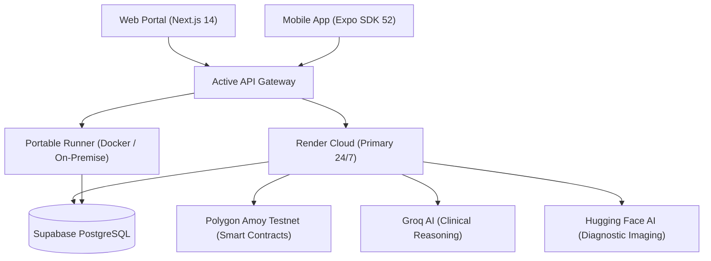

# MedSync - Decentralized AI Healthcare Platform

[](https://nextjs.org/)
[](https://fastapi.tiangolo.com/)
[](https://expo.dev/)
[](https://polygon.technology/)
[](https://www.docker.com/)

MedSync is an enterprise-grade, decentralized healthcare ecosystem integrating **electronic health records (EHR)**, **AI-assisted clinical diagnostics**, **cryptographic patient consent**, and **automated pharmacy fulfillment** across web, mobile, and edge environments.

---

## 🌟 Key Features

- **🔐 Zero-Knowledge Patient Vault**: End-to-end encrypted medical document storage with mandatory 6-digit PIN authorization, cryptographic signature verification, and granular doctor consent management.
- **👨‍⚕️ Clinician & Doctor Suite**: Digital consultation workspace with persistent clinical notes, diagnostic imaging reviews, smart multi-criteria patient filtering, and seamless electronic prescription generation.
- **💊 Pharmacy & Dispensing Portal**: Real-time prescription fulfillment queue, inventory tracking, and cryptographic verification of issued medication orders.
- **🧠 Hybrid AI Diagnostics & Clinical RAG**:
  - **PULSE AI Assistant**: Clinical decision support and medical reasoning powered by Groq Llama-3 / GPT-OSS models.
  - **Diagnostic Microservices**: YOLO & EfficientNet diagnostic pipelines for bone fracture detection, brain tumor analysis, kidney stone scans, and dermatological conditions.
- **⛓️ Polygon On-Chain Verification**: Immutable auditing of doctor registrations, patient consents, and prescription hashes deployed on the Polygon Amoy testnet.
- **🚀 Portable Runner & Cloud Gateway**: Dual-tier backend architecture supporting 24/7 Render Cloud failover, local developer sandboxes, and on-premises Docker execution via secure Ngrok tunnels.

---

## 🏗️ Architecture Overview



---

## 📁 Repository Structure

```text
Medsync/
├── apps/
│   ├── backend/        # FastAPI async backend, SQLAlchemy models, Pydantic v2 schemas
│   ├── web/            # Next.js 14 web portal (Patient, Doctor, Pharmacy, Admin)
│   ├── mobile/         # React Native / Expo 52 cross-platform mobile application
│   └── blockchain/     # Hardhat project with Solidity registries & deployment scripts
├── portable_runner/    # Zero-config Windows/Linux Docker orchestration scripts
├── install-medsync.ps1 # 1-click Windows installer script
└── README.md           # Documentation & guides
```

---

## ⚡ Quick Start: Portable Runner (Windows)

The Portable Runner allows you to run the complete MedSync backend locally on any machine using Docker with zero manual Git cloning or Python compilation.

### 1-Click Automated Installation
Open **PowerShell as Administrator** and run:

```powershell
curl.exe -L --fail --retry 3 -o "$env:TEMP\install-medsync.ps1" "https://raw.githubusercontent.com/dharshankumar988/Medsync/main/install-medsync.ps1"; powershell.exe -ExecutionPolicy Bypass -File "$env:TEMP\install-medsync.ps1"
```

The installer will:
1. Prompt for your preferred installation folder (default: `~\MedSync`).
2. Download and unpack the latest verified `portable_runner.zip`.
3. Verify Docker Desktop is installed and running.
4. Auto-generate your local `.env` configuration file from `.env.example`.
5. Launch the runner in your selected mode.

### Running & Controlling the Backend
Inside your installed `portable_runner` directory:

| Action | Windows Command | Linux / macOS Command |
|---|---|---|
| **Start (Desktop)** | `.\start-medsync.bat` | `./start-medsync.sh` |
| **Start (Headless/Remote)** | `powershell -File .\start-medsync.ps1 -Remote -Headless` | `./start-medsync.sh -r` |
| **Check Live Status** | `.\medsync-status.bat` | `./medsync-status.sh` |
| **Update Container** | `.\update-medsync.bat` | `./update-medsync.sh` |
| **Stop Runner** | `.\stop-medsync.bat` | `./stop-medsync.sh` |

---

## 📱 Mobile App (React Native / Expo)

The MedSync mobile application is built with React Native and Expo SDK 52, featuring a 5-tab patient vault (Records, Prescriptions, Orders, Consultations, Privacy), offline record caching, and biometric/PIN authentication.

### Local Development
```powershell
cd apps/mobile
pnpm install
npx expo start
```
Scan the displayed QR code with the **Expo Go** app on Android or iOS.

### Building Standalone Android APK (EAS Build)
To build a standalone installable Android APK (`.apk`):

```powershell
cd apps/mobile

# 1. Install EAS CLI globally if not present
npm install -g eas-cli

# 2. Login to your Expo account
eas login

# 3. Configure EAS project credentials (first time only)
eas build:configure

# 4. Trigger cloud preview build (generates direct APK download link)
eas build --platform android --profile preview
```

### Over-The-Air (OTA) Instant Updates
Deploy updates directly to users' devices without re-submitting to app stores:

```powershell
cd apps/mobile
eas update --branch preview --message "Fix vault PIN unlock and records cache"
```

---

## 💻 Web Application (Next.js 14)

### Local Development
```powershell
cd apps/web
pnpm install
pnpm dev
```
Open [http://localhost:3000](http://localhost:3000) in your browser.

### Production Build Verification
```powershell
cd apps/web
pnpm build
```

---

## ⚙️ Backend Development & Integrity Testing

The backend is built with FastAPI, async SQLAlchemy, and strictly typed Pydantic schemas.

### Environment Setup
```powershell
cd apps/backend
python -m venv venv_dev
.\venv_dev\Scripts\Activate.ps1
pip install -r requirements.txt
```

### Running Backend Integrity Tests
MedSync enforces strict model-schema contracts and API type safety:

```powershell
cd apps/backend
.\venv_dev\Scripts\pytest.exe tests/test_model_schema_integrity.py tests/api/test_admin_graph.py tests/test_pharmacy_doctor_registry_flow.py
```

---

## ⛓️ Smart Contracts (Polygon Amoy Testnet)

MedSync deploys 6 core registries on Polygon Amoy for decentralized verification:

| Contract | Purpose | Network |
|---|---|---|
| **Patient Registry** | Identity & DID bindings | Polygon Amoy |
| **Doctor Registry** | Medical license & verified credential state | Polygon Amoy |
| **Pharmacy Registry** | Dispensing license & outlet authorization | Polygon Amoy |
| **Medical Record Registry** | Cryptographic hash & timestamp integrity | Polygon Amoy |
| **Prescription Registry** | Non-repudiable doctor prescription hashing | Polygon Amoy |
| **Consent Manager** | Granular patient-to-doctor record permissions | Polygon Amoy |

---

## 🔒 Security Best Practices

1. **Never Commit Secrets**: Never commit `.env` or files containing live API keys, private keys, or passwords.
2. **Template Variables**: Always use `.env.example` with blank or dummy values for version control.
3. **PIN Protection**: Patient sensitive documents are encrypted and require PIN validation for offline decrypt or view.
4. **CORS Isolation**: In production, CORS is restricted to verified web domains and secure tunnel endpoints.

---

## 📄 License & Attribution

© 2026 Dharshankumar988. All rights reserved.

- **Face Recognition Notice**: The face verification service utilizes InsightFace `buffalo_l`. Use is restricted to research and non-commercial evaluation under InsightFace terms.
- Commercial redistribution or unauthorized copying requires express written consent from the copyright holder.
